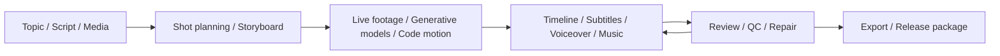

# awesome_ai_video_creation

**Curated open-source AI video generation, editing, agentic production, code-to-video, digital presenters, ComfyUI workflows, media CLIs, and benchmarks — with evidence-linked descriptions and reproducible GitHub maintenance rankings.**

This directory covers the full pipeline: licensed media acquisition, script and shot planning, image/video generation, digital humans, timeline editing, subtitles and voiceover, motion graphics, quality checks, and export. Models, workbenches, Skills, CLIs and benchmarks are categorized separately.

[Category index](#category-index) · [Project details](docs/projects.md) · [CLI comparison](docs/cli-comparison.md) · [Rankings](docs/rankings.md) · [Research log](docs/research.md) · [Contributing](CONTRIBUTING.md)

The first release provides a verifiable ecosystem map; it does not claim to cover every video model, commercial API or traditional NLE plugin.
