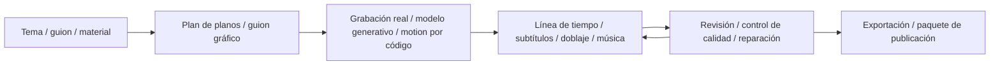

# awesome_ai_video_creation

**Catálogo abierto de generación y edición de vídeo con IA, vídeos cortos de conocimiento, avatares digitales, Agent Skills, ComfyUI y CLIs de medios.**

Curación open source de generación y edición de vídeo con IA, producción con agentes, código-a-vídeo, presentadores digitales, flujos ComfyUI, CLIs de medios y benchmarks — con descripciones enlazadas a evidencia y rankings reproducibles de mantenimiento en GitHub.

Este catálogo cubre la cadena completa: obtención legítima de material, planificación de guion y planos, generación de imagen/vídeo, avatares digitales, montaje en línea de tiempo, subtítulos y doblaje, motion graphics, control de calidad y exportación. Modelos, estudios, Skills, CLIs y benchmarks se clasifican por separado.

[Índice de categorías](#índice-de-categorías) · [Ficha detallada de proyectos](docs/projects.md) · [Comparativa de CLIs](docs/cli-comparison.md) · [Ordenaciones](docs/rankings.md) · [Registro de búsqueda](docs/research.md) · [Contribuir](CONTRIBUTING.md)

La primera versión ofrece un mapa verificable del ecosistema; no pretende agotar todos los modelos de vídeo, las APIs comerciales ni los complementos de NLE tradicionales.
