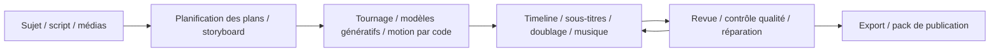

🌐 [English](../../README.md) · [简体中文](../zh/README.md) · [Español](../es/README.md) · [हिन्दी](../hi/README.md) · **Français**

# awesome_ai_video_creation

**Collection open source de génération vidéo, montage, vidéos courtes de savoir, avatars numériques, Agent Skills, ComfyUI et médias CLI par IA.**

Sélection curated de projets open source de génération vidéo par IA, de montage, de production agentique, de code-vers-vidéo, de présentateurs numériques, de workflows ComfyUI, de CLIs médias et de benchmarks — avec des descriptions liées à des preuves et des classements de maintenance GitHub reproductibles.

Ce catalogue couvre toute la chaîne : obtention légale des médias, script et planification des plans, génération d'images et de vidéos, avatars numériques, montage en timeline, sous-titres et doublage, motion design, contrôle qualité et export. Modèles, ateliers, Skills, CLI et benchmarks sont classés séparément.

[Index par catégorie](#index-par-catégorie) · [Détail des projets](docs/projects.md) · [Comparatif CLI](docs/cli-comparison.md) · [Classements](docs/rankings.md) · [Journal de recherche](docs/research.md) · [Contribuer](CONTRIBUTING.md)



La première version offre une carte vérifiable de l'écosystème ; elle ne prétend pas recenser tous les modèles vidéo, les API commerciales ni les plugins de NLE traditionnels.

## Aller à une catégorie

[Éditeurs vidéo et ateliers de production](#éditeurs-vidéo-et-ateliers-de-production) · [Production vidéo agentique et automatisation](#production-vidéo-agentique-et-automatisation) · [Vidéos courtes de savoir, extraits et vulgarisation](#vidéos-courtes-de-savoir-extraits-et-vulgarisation) · [Agent Skills, MCP et outils de montage](#agent-skills-mcp-et-outils-de-montage) · [Code-to-video et motion design](#code-to-video-et-motion-design) · [Animation, 3D et briques de base du codage](#animation-3d-et-briques-de-base-du-codage) · [ComfyUI et génération vidéo open source](#comfyui-et-génération-vidéo-open-source) · [Avatars numériques, animation de portrait et synchronisation labiale](#avatars-numériques-animation-de-portrait-et-synchronisation-labiale) · [Téléchargement, capture, transcodage et médias CLI](#téléchargement-capture-transcodage-et-médias-cli) · [Benchmarks, recherche et index externes](#benchmarks-recherche-et-index-externes) · [Versions historiques et restreintes](#versions-historiques-et-restreintes)

## Sélection actuelle

**109 projets, dont 22 référencés par l'utilisateur et 87 ajoutés lors de cette passe.** Vérification fonctionnelle : 2026-11-25 ; instantané des métriques : `2026-11-25T00:17:13+00:00` (UTC).

Dans chaque catégorie, les projets sont d'abord stratifiés par état de maintenance, puis classés par une combinaison d'étoiles (40 %), de commits sur la branche par défaut à 90 jours (35 %) et de récence du dernier commit (25 %). Le score de maintenance ne représente ni la qualité des montages, ni la capacité des modèles, ni la sécurité des droits, ni la maturité de production.

## Aperçu des projets principaux actifs

N'affiche que les candidats principaux, à licence ouverte vérifiée, avec un commit sur les 90 derniers jours ; les licences restreintes, les modèles de base, les benchmarks de recherche et les outils adjacents n'entrent pas dans ce tableau.

| Projet | Positionnement | Étoiles | Commits 90 j | Dernier commit UTC | Score de maintenance |
| --- | --- | --- | --- | --- | --- |
| [HyperFrames](https://github.com/heygen-com/hyperframes) | Écosystème de code-video HTML/CSS/JS et d'Agent Skills, avec migration possible depuis Remotion et validation image par image. | 89,564 | 3,965 | 2026-11-24 | 99.6 |
| [Concat](https://github.com/jub0t/Concat) | Éditeur multi-piste local multiplateforme avec sous-titres, TTS, détourage, images clés, effets et export 4K. | 19,997 | 1,677 | 2026-11-25 | 94.4 |
| [OpenMontage](https://github.com/OpenMontageInc/OpenMontage) | Système de production vidéo multi-pipelines pour coding agents : recherche, script, médias, doublage, sous-titres et rendu. | 83,059 | 272 | 2026-11-16 | 93.6 |
| [OpenMotion](https://github.com/nexu-io/openmotion) | Atelier de duplication de vidéos de référence et de motion design de marque pour coding agents locaux, avec Motion.md, timeline visuelle et export MP4. | 16,018 | 758 | 2026-11-24 | 93.6 |
| [FFmpeg Skill](https://github.com/kajisho5/ffmpeg-skill) | CLI et MCP offrant aux coding agents montage FFmpeg local, sous-titres, export de formats et contrôle de sortie. | 10,672 | 966 | 2026-11-24 | 92.0 |
| [Jellyfish](https://github.com/Forget-C/Jellyfish) | Atelier de production de dramas courts IA couvrant découpage du script, plans, gestion des assets personnages et décors, génération de shots et export. | 7,311 | 1,665 | 2026-11-23 | 90.4 |
| [yt-dlp](https://github.com/yt-dlp/yt-dlp) | Téléchargeur audio-vidéo en ligne de commande riche en fonctions couvrant un grand nombre de sites. | 210,460 | 81 | 2026-11-24 | 89.7 |
| [OpenFilm](https://github.com/openfilm/openfilm) | Permet aux coding agents de créer, inspecter, éditer et rendre des vidéos par le code, avec une interface éditable. | 9,289 | 298 | 2026-11-23 | 88.4 |
| [Clypra](https://github.com/AIEraDev/Clypra) | Éditeur vidéo multiplateforme accéléré par le matériel, construit en Rust/Tauri/React. | 3,374 | 1,916 | 2026-11-22 | 87.5 |
| [Claude Code Video Toolkit](https://github.com/digitalsamba/claude-code-video-toolkit) | Skills, templates, commandes et outils pour Claude Code : script, doublage, musique, génération d'images et de vidéos, contrôle qualité, rendu et publication, avec migration possible vers Codex et Kiro CLI. | 2,751 | 537 | 2026-11-24 | 87.5 |
| [CozyClay](https://github.com/HaD0Yun/CozyClay) | Outil navigateur de construction de décors, placement des personnages, découpage de plans et prévisualisation vidéo par IA. | 2,026 | 2,169 | 2026-11-24 | 86.3 |
| [Manim Community](https://github.com/ManimCommunity/manim) | Moteur vidéo d'animation mathématique et de vulgarisation programmée en Python. | 42,881 | 78 | 2026-11-23 | 86.3 |

## Index par catégorie

`★référence utilisateur` signale un projet fourni directement par l'utilisateur. Modèles, éditeurs, Skills, CLI et benchmarks sont classés séparément.

| Catégorie | Nombre | Projets les mieux classés en maintenance |
| --- | --- | --- |
| Éditeurs vidéo et ateliers de production | 19 | Concat, Jellyfish, Clypra |
| Production vidéo agentique et automatisation | 9 | Hypit, OpenMontage, OpenMotion |
| Vidéos courtes de savoir, extraits et vulgarisation | 10 | NeonClipping, Clipmint, ChrisHKAI Video |
| Agent Skills, MCP et outils de montage | 16 | FFmpeg Skill, Claude Code Video Toolkit, Video Shotcraft |
| Code-to-video et motion design | 9 | HyperFrames, Remotion, raea |
| Animation, 3D et briques de base du codage | 15 | Godot, three.js, Motion |
| ComfyUI et génération vidéo open source | 9 | VRGameDevGirl AI Video Builder, LTX-Video, HunyuanVideo |
| Avatars numériques, animation de portrait et synchronisation labiale | 5 | LiveTalking, MuseTalk, LivePortrait |
| Téléchargement, capture, transcodage et médias CLI | 8 | FFmpeg, yt-dlp, Streamlink |
| Benchmarks, recherche et index externes | 8 | Aurora / AgentEdit-Bench, Awesome AI Video for Creators, CutCraft Bench |
| Versions historiques et restreintes | 1 | Palmier Pro |

### Éditeurs vidéo et ateliers de production

| Projet | Positionnement | Étoiles | Commits 90 j | Dernier commit UTC | Score de maintenance | Licence |
| --- | --- | --- | --- | --- | --- | --- |
| [Concat](https://github.com/jub0t/Concat) · ★référence utilisateur | Éditeur multi-piste local multiplateforme avec sous-titres, TTS, détourage, images clés, effets et export 4K. | 19,997 | 1,677 | 2026-11-25 | 94.4 | AGPL-3.0 |
| [Jellyfish](https://github.com/Forget-C/Jellyfish) | Atelier de production de dramas courts IA couvrant découpage du script, plans, gestion des assets personnages et décors, génération de shots et export. | 7,311 | 1,665 | 2026-11-23 | 90.4 | Apache-2.0 |
| [Clypra](https://github.com/AIEraDev/Clypra) · ★référence utilisateur | Éditeur vidéo multiplateforme accéléré par le matériel, construit en Rust/Tauri/React. | 3,374 | 1,916 | 2026-11-22 | 87.5 | MIT |
| [CozyClay](https://github.com/HaD0Yun/CozyClay) · ★référence utilisateur | Outil navigateur de construction de décors, placement des personnages, découpage de plans et prévisualisation vidéo par IA. | 2,026 | 2,169 | 2026-11-24 | 86.3 | AGPL-3.0 |
| [Huobao Drama](https://github.com/chatfire-AI/huobao-drama) · Attention licence | Plateforme web/desktop qui, d'une phrase ou d'un roman collé, réécrit le script, génère images, vidéos de plans, doublage et sous-titres, puis assemble un drame court complet ; l'arrière-plan est orchestré par des agents Mastra et les skills sont éditables dans l'interface. | 17,971 | 108 | 2026-11-21 | 84.4 | CC BY-NC-SA-4.0 (usage commercial interdit) |
| [OpenChatCut](https://github.com/0xsline/OpenChatCut) · ★référence utilisateur | Éditeur vidéo conversationnel IA local-first avec timeline multi-piste, Agent Skills, MCP et rendu Remotion. | 3,310 | 403 | 2026-11-12 | 83.7 | AGPL-3.0 |
| [OpenDirector](https://github.com/ThinkFlowLab/OpenDirector) | Workflow de création vidéo agentique, de la conversation et du canvas à l'organisation des médias jusqu'à l'export de la timeline. | 437 | 348 | 2026-11-24 | 79.0 | Apache-2.0 |
| [AID Studio](https://github.com/shijue-aid/aid-studio) | Atelier auto-hébergeable de création de BD animées, dramas courts et productions audiovisuelles IA : script, personnages et décors, storyboard, génération d'images et de vidéos, doublage, canvas infini et prévisualisation 3D. | 1,764 | 125 | 2026-11-22 | 77.6 | MIT |
| [CutVoke](https://github.com/frankShan001/CutVoke) | Éditeur vidéo open source local-first multiplateforme avec serveur MCP intégré, permettant à des agents comme Claude Code, Codex ou Cursor de monter aux côtés des humains sur la même timeline multi-piste non destructive. | 45 | 505 | 2026-11-24 | 73.3 | MIT |
| [OpenReel Video](https://github.com/Augani/openreel-video) · ★référence utilisateur | Éditeur timeline open source, navigateur et desktop, avec coupe, sous-titres, mixage audio et export sans filigrane. | 6,446 | 19 | 2026-11-23 | 71.9 | MIT |
| [AI Video Production Editor](https://github.com/LudwigKienle/ai-video-production-editor) · ★référence utilisateur | Atelier local couvrant script, traitement de mise en scène, storyboard, génération des plans, puis montage, étalonnage et export. | 194 | 144 | 2026-11-20 | 70.1 | GPL-3.0 |
| [MakeMyClip Editor](https://github.com/MakeMyClip/editor) | Encapsule les capacités de montage de FFmpeg via une timeline dans le navigateur local, un CLI, MCP et un Skill. | 36 | 153 | 2026-11-16 | 63.6 | MIT |
| [OpenKatana](https://github.com/rk0neki/OpenKatana) | Moteur de montage vidéo piloté par agent : Studio, CLI, MCP et ComfyUI. | 85 | 126 | 2026-11-04 | 62.5 | Apache-2.0 |
| [OpenScene](https://github.com/Theorvane/OpenScene) | Éditeur vidéo desktop local où des agents IA peuvent manipuler la timeline, générer des médias et exporter. | 11 | 113 | 2026-11-24 | 60.3 | MIT |
| [Waoowaoo](https://github.com/waooAI/waoowaoo) · Attention licence | Atelier de création d'images et de vidéos IA gérant médias de référence et contenus générés via canvas et Assistant, avec assemblage de segments vidéo. | 14,979 | 6 | 2026-09-21 | 56.6 | Elastic License 2.0 |
| [SeeCut](https://github.com/YeJe-cpu/SeeCut) · ★référence utilisateur · Attention licence | Espace de skills faisant comprendre, monter, rendre et contrôler visuellement par un coding agent des vidéos courtes d'explication face caméra. | 487 | 11 | 2026-10-30 | 54.3 | PolyForm Noncommercial-1.0.0 |
| [ScriptCut](https://github.com/FernandoAbishai/ScriptCut) | Montage local, découpage en formats courts et export réseaux sociaux pilotés depuis l'édition du texte de transcription. | 23 | 62 | 2026-10-14 | 50.1 | AGPL-3.0 |
| [Cutline](https://github.com/Aepzie/cutline) | Éditeur timeline dans le navigateur offrant une interface MCP de premier plan pour une manipulation en direct par des agents. | 1 | 109 | 2026-10-16 | 45.0 | MIT |
| [Moyin Creator](https://github.com/MemeCalculate/moyin-creator) · Attention licence | Outil desktop Electron de production audiovisuelle IA qui enchaîne automatiquement un pipeline en cinq étapes — script, personnages, scènes, mise en scène, Seedance 2.0 — pour produire en série des dramas courts et des séries d'animation. | 4,871 | 2 | 2026-08-27 | 44.9 | AGPL-3.0 + double licence commerciale |

### Production vidéo agentique et automatisation

| Projet | Positionnement | Étoiles | Commits 90 j | Dernier commit UTC | Score de maintenance | Licence |
| --- | --- | --- | --- | --- | --- | --- |
| [Hypit](https://github.com/hypit-ai/hypit) · Attention licence | Permet aux coding agents de dupliquer des vidéos de référence en workflows éditables et rejouables, puis de générer des variantes de contenu par lot. | 31,391 | 783 | 2026-11-24 | 95.8 | Hypit Open Source License (Apache-2.0 modifiée) |
| [OpenMontage](https://github.com/OpenMontageInc/OpenMontage) | Système de production vidéo multi-pipelines pour coding agents : recherche, script, médias, doublage, sous-titres et rendu. | 83,059 | 272 | 2026-11-16 | 93.6 | AGPL-3.0 |
| [OpenMotion](https://github.com/nexu-io/openmotion) | Atelier de duplication de vidéos de référence et de motion design de marque pour coding agents locaux, avec Motion.md, timeline visuelle et export MP4. | 16,018 | 758 | 2026-11-24 | 93.6 | Apache-2.0 |
| [OpenFilm](https://github.com/openfilm/openfilm) | Permet aux coding agents de créer, inspecter, éditer et rendre des vidéos par le code, avec une interface éditable. | 9,289 | 298 | 2026-11-23 | 88.4 | MIT |
| [Rea Video](https://github.com/JuneYaooo/rea-video) · ★référence utilisateur | Déconstruit en retour les parts tournées, IA et code d'une vidéo et produit un plan de duplication au niveau du plan ainsi qu'un VIDEO.md. | 12,996 | 215 | 2026-11-24 | 88.1 | Apache-2.0 |
| [Video Autopilot Kit](https://github.com/Hao0321/video-autopilot-kit) · ★référence utilisateur | Framework d'automatisation pour la planification vidéo, l'audit, la revue et l'apprentissage des effets. | 2,358 | 51 | 2026-11-13 | 71.1 | MIT |
| [Video Use](https://github.com/browser-use/video-use) | Montage, sous-titres, étalonnage, incrustation de motion design et contrôle de sortie sur des rushes bruts via coding agent et FFmpeg. | 31,531 | 5 | 2026-10-08 | 60.9 | MIT |
| [Video Director](https://github.com/win4r/video-director) · ★référence utilisateur | Guide Claude Code pour planifier, rendre et contrôler des courts métrages via HTML/Canvas/SVG/Three.js/GSAP/Remotion. | 528 | 19 | 2026-11-07 | 59.2 | MIT |
| [WeVisCut](https://github.com/Tencent/WeVisCut) | Transforme des articles de savoir ou des scripts d'explication en vidéos de plusieurs minutes via planification, recherche de médias, montage, contrôle et réparation. | 114 | 29 | 2026-10-30 | 54.4 | Apache-2.0 |

### Vidéos courtes de savoir, extraits et vulgarisation

| Projet | Positionnement | Étoiles | Commits 90 j | Dernier commit UTC | Score de maintenance | Licence |
| --- | --- | --- | --- | --- | --- | --- |
| [NeonClipping](https://github.com/iamajmeena/neonclipping) | Collez un lien pour découper localement de longues vidéos YouTube/Twitch/Kick ou vos propres MP4 en segments 9:16 aux sous-titres incrustés, avec titres et accroches générés. | 2,482 | 89 | 2026-11-24 | 77.4 | MIT |
| [Clipmint](https://github.com/kleZ799/clipmint) | Convertit podcasts, interviews, tutoriels et VOD en Shorts/Reels/TikTok verticaux sous-titrés. | 68 | 620 | 2026-11-24 | 74.5 | MIT |
| [ChrisHKAI Video](https://github.com/ChrisHKAI/ChrisHKAI-Video) · ★référence utilisateur | Skill de coding agent organisant les ressources publiques d'un créateur en courts métrages 3D façon jouet. | 162 | 198 | 2026-11-24 | 72.4 | MIT |
| [Lanshu AI Presenter Video](https://github.com/cclank/lanshu-create-ai-presenter-video) · ★référence utilisateur | Agent Skill transformant un sujet ou un script en vidéo d'explication validée avec avatar numérique ou style. | 3,079 | 16 | 2026-10-11 | 59.2 | MIT |
| [Claude Animated Shorts](https://github.com/mromidev/claude-animated-shorts) · ★référence utilisateur | Skill de courts métrages verticaux d'histoires animées avec Three.js, Remotion, musique et effets sonores. | 4,811 | 2 | 2026-11-01 | 54.8 | MIT |
| [Vibe Knowledge](https://github.com/andyhuo520/vibe-knowledge) · ★référence utilisateur | Skill de capsules de savoir : vérification du point de savoir, rédaction, doublage, vidéo par code, contrôle qualité et pack de publication. | 805 | 3 | 2026-10-28 | 49.5 | MIT |
| [Vox Director](https://github.com/alisa0808/vox-director) | Agent Skill de bout en bout : du sujet à une vidéo d'explication/publicité en collage papier façon Vox. | 3,127 | 1 | 2026-10-05 | 46.2 | MIT |
| [Video to Shorts Skill](https://github.com/social-media-skills/video-to-shorts-skill) | Fait transformer par un agent de longues vidéos ou des podcasts en shorts verticaux sous-titrés mot à mot, avec publication optionnelle. | 4 | 3 | 2026-11-11 | 35.0 | MIT |
| [Pixelle-Video](https://github.com/ATH-MaaS/Pixelle-Video) | Génère texte, images ou vidéos, doublage et assemblage en vidéo courte à partir d'un sujet ; workflows ComfyUI et API médias pris en charge. | 30,491 | 0 | 2026-06-14 | 39.9 | Apache-2.0 |
| [Atlas Explainer](https://github.com/AtlasCloudAI/atlas-explainer) | Skill/CLI générant une vidéo d'explication papercraft doublée à partir d'un seul sujet. | 3 | 0 | 2026-07-10 | 10.2 | MIT |

### Agent Skills, MCP et outils de montage

| Projet | Positionnement | Étoiles | Commits 90 j | Dernier commit UTC | Score de maintenance | Licence |
| --- | --- | --- | --- | --- | --- | --- |
| [FFmpeg Skill](https://github.com/kajisho5/ffmpeg-skill) | CLI et MCP offrant aux coding agents montage FFmpeg local, sous-titres, export de formats et contrôle de sortie. | 10,672 | 966 | 2026-11-24 | 92.0 | MIT |
| [Claude Code Video Toolkit](https://github.com/digitalsamba/claude-code-video-toolkit) | Skills, templates, commandes et outils pour Claude Code : script, doublage, musique, génération d'images et de vidéos, contrôle qualité, rendu et publication, avec migration possible vers Codex et Kiro CLI. | 2,751 | 537 | 2026-11-24 | 87.5 | MIT |
| [Video Shotcraft](https://github.com/Vincentwei1021/video-shotcraft) · ★référence utilisateur | Fournit aux agents des recettes de plans, des storyboards, des animations Remotion, un montage rythmé et un contrôle image par image. | 22,444 | 54 | 2026-11-21 | 81.5 | Apache-2.0 |
| [Kinocut](https://github.com/KyaniteLabs/kinocut) | MCP/Python/CLI de montage vidéo local avec garde-fous, pré-vols, reçus et portes qualité. | 280 | 659 | 2026-11-24 | 79.5 | Apache-2.0 |
| [Remotion Agent Skills](https://github.com/remotion-dev/skills) · Attention licence | Skills officiels permettant aux coding agents de créer, prévisualiser et rendre des vidéos Remotion. | 7,954 | 31 | 2026-11-24 | 75.6 | Licence à vérifier |
| [Manju Laoli Skill](https://github.com/lixiaoxiao9888-create/manju-laoli-skill) | Pack de skills OpenClaw pour BD animées et dramas courts IA : script, verrouillage des assets, storyboard, scènes de combat, prompts d'alimentation Seedance et contrôles automatiques. | 3,081 | 50 | 2026-11-19 | 73.5 | MIT |
| [pixelfx](https://github.com/patch-gg/pixelfx) · Attention licence | Bibliothèque de 244 effets pixel et animations dessinés par code, avec un skill Claude Code de génération d'effets et des outils de spritesheet et d'export GIF/MP4. | 9,055 | 10 | 2026-11-12 | 66.9 | MIT (code et effets) + police Patch Pixel exclue |
| [Wallstreet Explainer](https://github.com/HeyChengC/wallstreet-explainer) · Attention licence | Skill de coding agent pour capsules financières/tech en style Wall Street : langage visuel de style, templates de composants graphiques, scripts de recherche d'extraits, de captures d'écran, de doublage, de détourage, de rendu et de mixage. | 1,312 | 16 | 2026-11-20 | 64.7 | MIT (code et documentation) + médias tiers des échantillons exclus |
| [ReelBench Skills](https://github.com/eternityspring/reelbench-skills) · ★référence utilisateur | Ensemble de skills d'analyse, de duplication et de production vidéo pour Claude Code/Codex. | 1,253 | 21 | 2026-11-09 | 63.3 | Apache-2.0 |
| [Video Agent Skills](https://github.com/Melvynx/video-agent-skills) | Organisation par skills Markdown du script, de la recherche, du montage, de la traduction et de la publication pour shorts/YouTube. | 211 | 26 | 2026-11-06 | 57.5 | MIT |
| [HyperFrames Motion Library](https://github.com/nutllwhy/hyperframes-motion-library) · ★référence utilisateur | Bibliothèque locale de templates de motion design et d'assets paramétriques reposant sur HyperFrames. | 326 | 2 | 2026-10-28 | 44.8 | MIT |
| [Video Editing Skill](https://github.com/social-media-skills/video-editing-skill) | Fait effectuer par l'agent la première passe de montage et le traitement des sous-titres sur des explications face caméra, des cours, des interviews et des vlogs. | 10 | 3 | 2026-11-11 | 37.7 | MIT |
| [GSAP Skills](https://github.com/greensock/gsap-skills) | Agent Skills officiels guidant les coding agents sur les timelines, l'animation et les plugins GSAP. | 19,019 | 0 | 2026-04-21 | 36.5 | MIT |
| [Narrator AI CLI Skill](https://github.com/NarratorAI-Studio/narrator-ai-cli-skill) · ★référence utilisateur | Guide l'agent pour piloter narrator-ai-cli et produire automatiquement des vidéos de commentaire de films et séries. | 3,323 | 0 | 2026-07-05 | 33.3 | MIT |
| [OpenClip Agent Skills](https://github.com/OpenClip-App/agent-skills) | Skills agent pour le découpage de longues vidéos, la transcription, la conversion, les miniatures, le détourage et les idées UGC. | 1 | 0 | 2026-08-07 | 9.8 | MIT |
| [MCP Video Editing](https://github.com/mfortne/mcp-video-editing) | Encapsulation MCP, bibliothèque Python et CLI de FFmpeg, HyperFrames et flux réutilisables en local. | 2 | 0 | 2026-06-04 | 7.5 | Apache-2.0 |

### Code-to-video et motion design

| Projet | Positionnement | Étoiles | Commits 90 j | Dernier commit UTC | Score de maintenance | Licence |
| --- | --- | --- | --- | --- | --- | --- |
| [HyperFrames](https://github.com/heygen-com/hyperframes) | Écosystème de code-video HTML/CSS/JS et d'Agent Skills, avec migration possible depuis Remotion et validation image par image. | 89,564 | 3,965 | 2026-11-24 | 99.6 | Apache-2.0 |
| [Remotion](https://github.com/remotion-dev/remotion) · Attention licence | Framework de base pour créer et rendre des vidéos par code en React/TypeScript. | 75,476 | 6,717 | 2026-11-24 | 99.0 | Remotion License |
| [raea](https://github.com/shinyobjectz/raea) · Attention licence | Moteur et atelier agent desktop pour écrire vidéos, animations, 3D et jeux en React/TypeScript, rendus sur un GPU local. | 5,002 | 1,457 | 2026-11-24 | 89.3 | FSL-1.1-ALv2 |
| [Lemo Opuscar](https://github.com/lemomo-ai/lemo-opuscar) · Attention licence | Fournit des styles cinéma, des exemples et des consignes STYLE.md pour que les coding agents fassent des vidéos par code. | 20,684 | 148 | 2026-11-23 | 87.2 | Code MIT + documentation CC BY-NC (licence additive) |
| [Manim Community](https://github.com/ManimCommunity/manim) | Moteur vidéo d'animation mathématique et de vulgarisation programmée en Python. | 42,881 | 78 | 2026-11-23 | 86.3 | MIT |
| [GiveMotion](https://github.com/givemotion/givemotion) | Moteur de code-video où l'agent écrit HTML/CSS, prévisualise, contrôle puis rend un MP4. | 92 | 243 | 2026-11-19 | 70.1 | MIT |
| [Manim](https://github.com/3b1b/manim) | Moteur d'animation Python pour la vulgarisation mathématique. | 96,918 | 1 | 2026-09-09 | 54.5 | MIT |
| [SenseNova Code2Video](https://github.com/OpenSenseNova/SenseNova-6.8-Code2Video) · ★référence utilisateur · Attention licence | Génère du code exécutable avec un petit modèle ouvert pour rendre de courtes vidéos. | 767 | 2 | 2026-10-27 | 47.5 | À vérifier |
| [Motion Canvas](https://github.com/motion-canvas/motion-canvas) | Crée des animations, des explications et du motion design en TypeScript via des fonctions génératrices. | 20,204 | 0 | 2026-07-02 | 39.4 | MIT |

### Animation, 3D et briques de base du codage

| Projet | Positionnement | Étoiles | Commits 90 j | Dernier commit UTC | Score de maintenance | Licence |
| --- | --- | --- | --- | --- | --- | --- |
| [Godot](https://github.com/godotengine/godot) | Moteur de jeu open source pour construire des scènes 2D et 3D, des interactions et des animations. | 120,738 | 1,923 | 2026-11-24 | 100.0 | MIT |
| [three.js](https://github.com/mrdoob/three.js) | Bibliothèque JavaScript de scènes et de rendu 3D, pour alimenter des animations par code en contenu 3D. | 119,308 | 874 | 2026-11-24 | 99.9 | MIT |
| [Motion](https://github.com/motiondivision/motion) | Bibliothèque d'animation d'interfaces et de mises en page pour JavaScript, React et Vue. | 35,531 | 1,390 | 2026-11-24 | 96.3 | MIT |
| [Blender](https://github.com/blender/blender) | Suite de création 3D couvrant modélisation, rigging, animation, rendu, compositing et montage vidéo. | 22,468 | 3,310 | 2026-11-25 | 94.8 | GPL-2.0-or-later |
| [Babylon.js](https://github.com/BabylonJS/Babylon.js) | Moteur JavaScript de scènes 3D, de jeux et de rendu, base possible pour le motion design par code. | 26,439 | 342 | 2026-11-24 | 93.2 | Apache-2.0 |
| [Konva](https://github.com/konvajs/konva) | Bibliothèque de scène Canvas 2D avec interaction d'objets, transformations, animations et export. | 15,012 | 217 | 2026-11-23 | 88.4 | MIT |
| [Two.js](https://github.com/jonobr1/two.js) | Crée des figures 2D et des scènes animées via WebGL, Canvas ou SVG. | 8,762 | 47 | 2026-11-17 | 76.3 | MIT |
| [Shifty](https://github.com/jeremyckahn/shifty) | Moteur d'animation de tweening en TypeScript avec easings et contrôles de lecture. | 1,598 | 14 | 2026-11-14 | 63.2 | MIT |
| [Ola](https://github.com/franciscop/ola) | Bibliothèque légère d'interpolation temporelle en temps réel de valeurs numériques. | 1,869 | 3 | 2026-10-24 | 51.6 | MIT |
| [Anime.js](https://github.com/juliangarnier/anime) | Animations en timeline sur des propriétés CSS, SVG, DOM et JavaScript. | 75,039 | 0 | 2026-08-09 | 46.6 | MIT |
| [Proton](https://github.com/drawcall/Proton) | Bibliothèque JavaScript d'animation de particules pour des effets de flammes, feux d'artifice et explosions. | 2,531 | 0 | 2026-03-06 | 28.6 | MIT |
| [Lottie Web](https://github.com/airbnb/lottie-web) | Analyse et affiche dans le web des animations vectorielles Lottie exportées. | 32,572 | 0 | 2024-11-19 | 36.1 | MIT |
| [TweenJS](https://github.com/CreateJS/TweenJS) | Tweening et lecture en chaîne pour des valeurs JavaScript et des propriétés CSS. | 3,578 | 0 | 2021-03-27 | 28.4 | MIT |
| [LUME](https://github.com/lume/lume) | Construit des scènes graphiques interactives 2D et 3D avec des éléments HTML. | 1,576 | 0 | 2025-10-14 | 25.9 | MIT |
| [gifenc](https://github.com/mattdesl/gifenc) | Encode des GIFs animés avec transparence dans le navigateur ou sous Node.js. | 382 | 0 | 2024-09-19 | 20.7 | MIT |

### ComfyUI et génération vidéo open source

| Projet | Positionnement | Étoiles | Commits 90 j | Dernier commit UTC | Score de maintenance | Licence |
| --- | --- | --- | --- | --- | --- | --- |
| [VRGameDevGirl AI Video Builder](https://github.com/vrgamegirl19/comfyui-vrgamedevgirl) · ★référence utilisateur · Attention licence | Gère dans ComfyUI, scène par scène, la planification, les prompts, la génération, le rythme, la revue et l'assemblage final. | 904 | 677 | 2026-11-24 | 83.6 | VRGameDevGirl Community and Commercial License |
| [LTX-Video](https://github.com/Lightricks/LTX-Video) | Modèles vidéo ouverts et outils d'inférence pour le texte et l'image vers la vidéo ainsi que la génération audio-visuelle. | 11,479 | 2 | 2026-11-02 | 58.2 | Apache-2.0 |
| [HunyuanVideo](https://github.com/Tencent-Hunyuan/HunyuanVideo) · Attention licence | Modèle de base de génération vidéo à grande échelle open source de Tencent, avec cadre d'inférence. | 12,827 | 3 | 2026-10-08 | 55.4 | Tencent Hunyuan Community License |
| [Wan2.2](https://github.com/Wan-Video/Wan2.2) | Modèles ouverts de génération vidéo de la série Wan d'Alibaba, couvrant le texte et l'image vers la vidéo. | 18,891 | 2 | 2026-09-21 | 52.6 | Apache-2.0 |
| [Mochi](https://github.com/genmoai/mochi) | Modèle de génération vidéo open source de Genmo avec code d'inférence. | 3,767 | 2 | 2026-10-22 | 52.1 | Apache-2.0 |
| [Open-Sora](https://github.com/hpcaitech/Open-Sora) | Cadre open source efficace d'entraînement et d'inférence pour la génération vidéo. | 29,949 | 0 | 2026-04-09 | 37.8 | Apache-2.0 |
| [Bernini](https://github.com/bytedance/Bernini) | Cadre de recherche en génération et édition vidéo associant un planificateur sémantique et un rendu DiT. | 1,373 | 0 | 2026-08-13 | 33.0 | Apache-2.0 |
| [HunyuanVideo-I2V](https://github.com/Tencent-Hunyuan/HunyuanVideo-I2V) · Attention licence | Cadre image-vers-vidéo personnalisable bâti sur HunyuanVideo. | 1,858 | 0 | 2026-04-07 | 28.1 | Tencent Hunyuan Community License |
| [CogVideo / CogVideoX](https://github.com/zai-org/CogVideo) | Modèles open source texte/image-vers-vidéo et code d'inférence. | 13,229 | 0 | 2025-11-04 | 33.3 | Apache-2.0 |

### Avatars numériques, animation de portrait et synchronisation labiale

| Projet | Positionnement | Étoiles | Commits 90 j | Dernier commit UTC | Score de maintenance | Licence |
| --- | --- | --- | --- | --- | --- | --- |
| [LiveTalking](https://github.com/lipku/LiveTalking) | Système de streaming interactif en temps réel combinant plusieurs backends d'avatars numériques. | 11,131 | 8 | 2026-10-20 | 61.5 | Apache-2.0 |
| [MuseTalk](https://github.com/TMElyralab/MuseTalk) | Modèle de présentateur virtuel piloté par l'audio pour une synchronisation labiale temps réel de haute qualité. | 7,031 | 1 | 2026-11-19 | 58.2 | MIT |
| [LivePortrait](https://github.com/KlingAIResearch/LivePortrait) | Cadre efficace d'animation de portrait, d'assemblage et de contrôle par redirection. | 19,566 | 0 | 2026-06-01 | 37.9 | MIT |
| [SadTalker](https://github.com/OpenTalker/SadTalker) | Génère une vidéo de tête parlante à partir d'un seul portrait et d'un fichier audio. | 14,220 | 0 | 2023-10-10 | 33.2 | Apache-2.0 |
| [Wav2Lip](https://github.com/Rudrabha/Wav2Lip) · Attention licence | Implémentation de recherche classique de la synchronisation labiale audio-vidéo. | 13,284 | 0 | 2025-06-22 | 33.1 | Licence personnelle/recherche/non commerciale |

### Téléchargement, capture, transcodage et médias CLI

| Projet | Positionnement | Étoiles | Commits 90 j | Dernier commit UTC | Score de maintenance | Licence |
| --- | --- | --- | --- | --- | --- | --- |
| [FFmpeg](https://github.com/FFmpeg/FFmpeg) · Attention licence | Chaîne à outils bas niveau de transcodage vidéo, filtres, muxing, composition et traitement de flux. | 68,093 | 2,986 | 2026-11-24 | 98.7 | LGPL-2.1+ ; GPL-2.0+ une fois les composants GPL activés |
| [yt-dlp](https://github.com/yt-dlp/yt-dlp) | Téléchargeur audio-vidéo en ligne de commande riche en fonctions couvrant un grand nombre de sites. | 210,460 | 81 | 2026-11-24 | 89.7 | Unlicense |
| [Streamlink](https://github.com/streamlink/streamlink) | CLI qui résout les flux en direct en ligne et les enchaîne vers un lecteur local. | 11,998 | 155 | 2026-11-18 | 84.4 | BSD-2-Clause |
| [Downvid](https://github.com/Downvid/downvid) · ★référence utilisateur | GUI/WebUI multiplateforme de téléchargement vidéo bâti sur yt-dlp et FFmpeg. | 1,678 | 354 | 2026-11-11 | 80.4 | MIT |
| [VidBee](https://github.com/nexmoe/VidBee) | Télécharge les médias puis exécute en local transcription, annotation des locuteurs, résumés, traduction et dialogue avec les médias. | 11,207 | 51 | 2026-11-21 | 78.6 | MIT |
| [cobalt](https://github.com/imputnet/cobalt) · Attention licence | Application web de téléchargement de médias sans publicité ni pistage, avec API auto-hébergeable, couvrant YouTube, TikTok, Instagram et d'autres sites. | 47,172 | 0 | 2026-04-06 | 39.3 | AGPL-3.0 (api et reste) + CC-BY-NC-SA-4.0 (web) |
| [Lux](https://github.com/iawia002/lux) | CLI écrit en Go pour le téléchargement vidéo multi-sites. | 31,857 | 0 | 2025-12-29 | 36.7 | MIT |
| [you-get](https://github.com/soimort/you-get) | Utilitaire Python en ligne de commande pour télécharger des médias depuis des pages web. | 56,849 | 0 | 2025-04-27 | 38.1 | MIT |

### Benchmarks, recherche et index externes

| Projet | Positionnement | Étoiles | Commits 90 j | Dernier commit UTC | Score de maintenance | Licence |
| --- | --- | --- | --- | --- | --- | --- |
| [Aurora / AgentEdit-Bench](https://github.com/yeates/Aurora) | Unifie le montage vidéo par un agent à usage d'outils et fournit AgentEdit-Bench. | 461 | 4 | 2026-11-13 | 52.5 | MIT |
| [Awesome AI Video for Creators](https://github.com/sasateguh/awesome-ai-video-for-creators) | Classe les outils open source par workflow de créateur : montage, sous-titres, clipping, doublage et vidéo par code. | 19 | 15 | 2026-11-24 | 50.9 | CC0-1.0 |
| [CutCraft Bench](https://github.com/AlibabaResearch/cut-craft-bench) · Attention licence | Évalue l'exécution de techniques de montage professionnelles dans la génération audio-vidéo multi-plans, avec une baseline agent. | 43 | 5 | 2026-09-14 | 34.5 | À vérifier |
| [Awesome Video Editing](https://github.com/devanasolver/awesome-video-editing) | Recense les outils open source de montage vidéo, les Agent Skills et les médias disponibles. | 5 | 2 | 2026-10-17 | 28.8 | CC0-1.0 |
| [Awesome AI Video](https://github.com/thoxakihiko/awesome-ai-video) | Recense les modèles, outils et ressources texte/image-vers-vidéo. | 3 | 3 | 2026-09-27 | 25.7 | CC0-1.0 |
| [VEFX-Bench](https://github.com/Visko-Platform/VEFX-Bench) | Évalue le respect des instructions et la qualité en montage vidéo généraliste et effets visuels. | 177 | 0 | 2026-05-16 | 20.9 | Apache-2.0 |
| [EditVerse](https://github.com/adobe-research/EditVerse) · Attention licence | Code de recherche en génération et édition d'images et de vidéos, avec EditVerseBench. | 140 | 0 | 2025-10-09 | 17.4 | Adobe Research License (fichiers partiels) |
| [Video-Bench](https://github.com/Video-Bench/Video-Bench) | Organise et exécute des évaluations multidimensionnelles des modèles de génération vidéo. | 82 | 0 | 2025-06-09 | 15.4 | Apache-2.0 |

### Versions historiques et restreintes

| Projet | Positionnement | Étoiles | Commits 90 j | Dernier commit UTC | Score de maintenance | Licence |
| --- | --- | --- | --- | --- | --- | --- |
| [Palmier Pro](https://github.com/palmier-io/palmier-pro) · ★référence utilisateur · Archivé/historique · Attention licence | Éditeur vidéo pensé pour l'IA dont les anciennes versions du code source sont sorties sous GPLv3. | 14,803 | 10 | 2026-11-20 | 70.5 | GPL-3.0 (sources jusqu'à v0.7.6) / binaires propriétaires ensuite |

## Comment choisir

- Vous avez des rushes à monter : voir les éditeurs/ateliers ou les Skills/MCP.
- Du sujet et du script jusqu'au montage final : voir la production agentique et les vidéos courtes de savoir.
- Motion design, démos produit et data storytelling : voir Code-to-video.
- Génération par diffusion en local : voir ComfyUI et les modèles open source.
- Avatars et présentateurs parlants : voir l'animation de portrait et la synchronisation labiale, en vérifiant d'abord les droits des personnes.
- Obtenir des médias correctement autorisés : voir [Comparatif CLI](docs/cli-comparison.md).

Limites complètes dans [le détail des projets](docs/projects.md) ; périmètre et catégories dans [Périmètre et taxonomie](docs/taxonomy.md).

## Données et maintenance

- [Classements composite, étoiles, activité, récence](docs/rankings.md)
- [Comparatif Downvid et CLI de téléchargement/médias](docs/cli-comparison.md)
- [Méthode de classement et limites](docs/methodology.md)
- [Mots-clés de recherche, sources et couverture](docs/research.md)
- [Guide de contribution](CONTRIBUTING.md)

```sh
python scripts/refresh_metrics.py
python scripts/build.py
python -m unittest discover -s tests -v
python scripts/build.py --check
```

## Licences et remerciements

Le travail éditorial original et les scripts de ce catalogue sont sous [licence MIT](../../LICENSE) ; les projets liés, les modèles, les poids, les médias et les polices suivent leurs propres licences. Le code source visible, l'usage non commercial, les modèles communautaires et les licences conditionnelles conservent leurs limites d'origine.

La découverte des projets s'est appuyée sur des index externes comme [Awesome Video Editing](https://github.com/devanasolver/awesome-video-editing) ; chaque entrée finale est revérifiée sur le dépôt officiel.

[Le journal des modifications](../../record/) conserve le texte d'origine (en chinois) tel qu'il était au moment de la vérification, afin d'auditer la source et la formulation de chaque décision.
