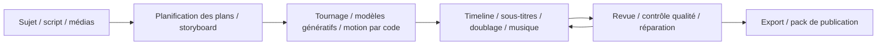

# awesome_ai_video_creation

**Collection open source de génération vidéo, montage, vidéos courtes de savoir, avatars numériques, Agent Skills, ComfyUI et médias CLI par IA.**

Sélection curated de projets open source de génération vidéo par IA, de montage, de production agentique, de code-vers-vidéo, de présentateurs numériques, de workflows ComfyUI, de CLIs médias et de benchmarks — avec des descriptions liées à des preuves et des classements de maintenance GitHub reproductibles.

Ce catalogue couvre toute la chaîne : obtention légale des médias, script et planification des plans, génération d'images et de vidéos, avatars numériques, montage en timeline, sous-titres et doublage, motion design, contrôle qualité et export. Modèles, ateliers, Skills, CLI et benchmarks sont classés séparément.

[Index par catégorie](#index-par-catégorie) · [Détail des projets](docs/projects.md) · [Comparatif CLI](docs/cli-comparison.md) · [Classements](docs/rankings.md) · [Journal de recherche](docs/research.md) · [Contribuer](CONTRIBUTING.md)

La première version offre une carte vérifiable de l'écosystème ; elle ne prétend pas recenser tous les modèles vidéo, les API commerciales ni les plugins de NLE traditionnels.
