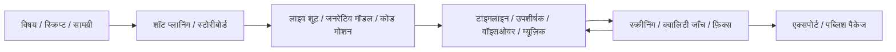

🌐 [English](../../README.md) · [简体中文](../zh/README.md) · [Español](../es/README.md) · **हिन्दी** · [Français](../fr/README.md)

# awesome_ai_video_creation

**ओपन-सोर्स AI वीडियो जनरेशन, वीडियो संपादन, ज्ञान-आधारित शॉर्ट वीडियो, डिजिटल प्रस्तोता, Agent Skills, ComfyUI और मीडिया CLI का संकलन।**

क्यूरेटेड ओपन-सोर्स AI वीडियो जनरेशन, एडिटिंग, एजेंटिक प्रोडक्शन, code-to-video, डिजिटल प्रस्तोता, ComfyUI वर्कफ़्लो, मीडिया CLI और benchmark — प्रमाण-लिंक वाले विवरण और दोबारा चलायी जा सकने वाली GitHub मेंटेनेंस रैंकिंग के साथ।

यह डायरेक्टरी कानूनी रूप से अधिकृत सामग्री के डाउनलोड, स्क्रिप्ट और शॉट प्लानिंग, इमेज/वीडियो जनरेशन, डिजिटल प्रस्तोता, टाइमलाइन संपादन, उपशीर्षक और वॉइसओवर, मोशन, क्वालिटी जाँच से लेकर एक्सपोर्ट तक की पूरी श्रृंखला को कवर करती है। मॉडल, वर्कबेंच, Skill, CLI और benchmark अलग-अलग श्रेणियों में रखे गए हैं।

[श्रेणी सूची](#श्रेणी-सूची) · [प्रोजेक्ट विवरण तालिका](docs/projects.md) · [CLI तुलना](docs/cli-comparison.md) · [रैंकिंग](docs/rankings.md) · [खोज रिकॉर्ड](docs/research.md) · [योगदान](CONTRIBUTING.md)



प्रारंभिक संस्करण एक जाँच-योग्य इकोसिस्टम नक्शा देता है; यह दावा नहीं करता कि सारे वीडियो मॉडल, वाणिज्यिक API या पारंपरिक NLE प्लगइन शामिल हैं।

## श्रेणी पर जाएँ

[वीडियो संपादक और प्रोडक्शन वर्कबेंच](#वीडियो-संपादक-और-प्रोडक्शन-वर्कबेंच) · [Agent वीडियो प्रोडक्शन और ऑटोमेशन](#agent-वीडियो-प्रोडक्शन-और-ऑटोमेशन) · [ज्ञान-आधारित शॉर्ट वीडियो, क्लिप और एक्सप्लेनर](#ज्ञान-आधारित-शॉर्ट-वीडियो-क्लिप-और-एक्सप्लेनर) · [Agent Skills, MCP और संपादन उपकरण](#agent-skills-mcp-और-संपादन-उपकरण) · [Code-to-video और मोशन](#code-to-video-और-मोशन) · [एनिमेशन, 3D और एन्कोडिंग बुनियादी घटक](#एनिमेशन-3d-और-एन्कोडिंग-बुनियादी-घटक) · [ComfyUI और ओपन-सोर्स वीडियो जनरेशन](#comfyui-और-ओपन-सोर्स-वीडियो-जनरेशन) · [डिजिटल प्रस्तोता, पोर्ट्रेट एनिमेशन और लिप-सिंक](#डिजिटल-प्रस्तोता-पोर्ट्रेट-एनिमेशन-और-लिप-सिंक) · [डाउनलोड, संग्रह, ट्रांसकोडिंग और सामग्री CLI](#डाउनलोड-संग्रह-ट्रांसकोडिंग-और-सामग्री-cli) · [बेंचमार्क, शोध और बाहरी इंडेक्स](#बेंचमार्क-शोध-और-बाहरी-इंडेक्स) · [ऐतिहासिक और प्रतिबंधित संस्करण](#ऐतिहासिक-और-प्रतिबंधित-संस्करण)

## वर्तमान संग्रह

**कुल 111 प्रोजेक्ट, जिनमें 22 उपयोगकर्ता संदर्भ प्रोजेक्ट हैं और 89 इस दौर में जोड़े गए।** फ़ंक्शन सत्यापन: 2026-11-26; मीट्रिक स्नैपशॉट: `2026-11-26T03:45:40+00:00` (UTC)।

हर श्रेणी में पहले मेंटेनेंस स्थिति के अनुसार लेयर बनाई जाती है, फिर star (40%), 90 दिन की डिफ़ॉल्ट-ब्रांच कमिट (35%) और नवीनतम कमिट (25%) मिलाकर क्रम तय होता है। मेंटेनेंस स्कोर फ़ाइनल वीडियो की गुणवत्ता, मॉडल की क्षमता, कॉपीराइट सुरक्षा या प्रोडक्शन परिपक्वता को नहीं दर्शाता।

## सक्रिय मुख्य प्रोजेक्ट की झलक

केवल मुख्य उम्मीदवार, सत्यापित खुला लाइसेंस रखने वाले और पिछले 90 दिनों में कमिट हुए प्रोजेक्ट ही यहाँ दिखते हैं; प्रतिबंधित लाइसेंस, बेस मॉडल, शोध बेंचमार्क और संलग्न उपकरण इस तालिका में नहीं आते।

| प्रोजेक्ट | भूमिका | Stars | 90-दिन कमिट | नवीनतम कमिट UTC | मेंटेनेंस स्कोर |
| --- | --- | --- | --- | --- | --- |
| [HyperFrames](https://github.com/heygen-com/hyperframes) | HTML/CSS/JS आधारित कोड-वीडियो और Agent Skill इकोसिस्टम; Remotion आदि से माइग्रेशन और फ़्रेम-दर-फ़्रेम सत्यापन के साथ। | 90,246 | 4,062 | 2026-11-26 | 99.6 |
| [Concat](https://github.com/jub0t/Concat) | लोकल क्रॉस-प्लेटफ़ॉर्म मल्टी-ट्रैक संपादक, जिसमें सबटाइटल, TTS, बैकग्राउंड हटाना, कीफ़्रेम, इफ़ेक्ट और 4K एक्सपोर्ट है। | 20,234 | 1,683 | 2026-11-25 | 94.1 |
| [OpenMotion](https://github.com/nexu-io/openmotion) | लोकल coding agent के लिए रेफ़रेंस-वीडियो रिप्लिकेशन और ब्रांडेड मोशन वर्कबेंच; Motion.md, विज़ुअल टाइमलाइन और MP4 एक्सपोर्ट के साथ। | 16,401 | 822 | 2026-11-26 | 93.7 |
| [OpenMontage](https://github.com/OpenMontageInc/OpenMontage) | coding agent के लिए मल्टी-पाइपलाइन वीडियो प्रोडक्शन सिस्टम: रिसर्च, स्क्रिप्ट, सामग्री, वॉइसओवर, सबटाइटल और रेंडरिंग। | 83,382 | 272 | 2026-11-16 | 93.3 |
| [FFmpeg Skill](https://github.com/kajisho5/ffmpeg-skill) | coding agent के लिए लोकल FFmpeg कट, सबटाइटल, फ़ॉर्मेट एक्सपोर्ट और आउटपुट जाँच का CLI और MCP। | 11,174 | 971 | 2026-11-25 | 92.3 |
| [Jellyfish](https://github.com/Forget-C/Jellyfish) | AI शॉर्ट ड्रामा प्रोडक्शन वर्कबेंच: स्क्रिप्ट ब्रेकडाउन, शॉट-वाइज़, कैरेक्टर व सीन एसेट मैनेजमेंट, शॉट जनरेशन और एक्सपोर्ट। | 7,334 | 1,666 | 2026-11-25 | 90.7 |
| [yt-dlp](https://github.com/yt-dlp/yt-dlp) | बहुत सारी साइट सपोर्ट करने वाला फ़ीचर-समृद्ध कमांड-लाइन ऑडियो-वीडियो डाउनलोडर। | 210,778 | 79 | 2026-11-24 | 89.3 |
| [OpenFilm](https://github.com/openfilm/openfilm) | coding agent को कोड से वीडियो बनाने, जाँचने, एडिट करने और रेंडर करने देता है, साथ में एडिट-योग्य इंटरफ़ेस। | 9,427 | 299 | 2026-11-25 | 88.8 |
| [Clypra](https://github.com/AIEraDev/Clypra) | Rust/Tauri/React से बना हार्डवेयर-एक्सेलेरेटेड क्रॉस-प्लेटफ़ॉर्म वीडियो संपादक। | 3,379 | 1,854 | 2026-11-25 | 88.0 |
| [Claude Code Video Toolkit](https://github.com/digitalsamba/claude-code-video-toolkit) | Claude Code के लिए स्क्रिप्ट, वॉइसओवर, म्यूज़िक, इमेज और वीडियो जनरेशन, क्वालिटी जाँच, रेंडरिंग और पब्लिशिंग की Skills, टेम्पलेट, कमांड व टूल; Codex और Kiro CLI में भी माइग्रेट हो सकता है। | 2,771 | 546 | 2026-11-25 | 87.4 |
| [Manim Community](https://github.com/ManimCommunity/manim) | Python कोड से गणित और ज्ञान-व्याख्या एनिमेशन बनाने का वीडियो इंजन। | 42,917 | 79 | 2026-11-25 | 86.6 |
| [CozyClay](https://github.com/HaD0Yun/CozyClay) | ब्राउज़र में सीन बनाने, कैरेक्टर मुवमेंट, शॉट कट और AI वीडियो प्रीविज़ करने का टूल। | 2,030 | 2,164 | 2026-11-25 | 86.4 |

## श्रेणी सूची

`★उपयोगकर्ता संदर्भ` उन प्रोजेक्टों को दर्शाता है जो उपयोगकर्ता ने सीधे दिए थे। मॉडल, संपादक, Skill, CLI और benchmark अलग-अलग श्रेणियों में रखे गए हैं।

| श्रेणी | संख्या | मेंटेनेंस क्रम में सबसे आगे के प्रोजेक्ट |
| --- | --- | --- |
| वीडियो संपादक और प्रोडक्शन वर्कबेंच | 19 | Concat, Jellyfish, Clypra |
| Agent वीडियो प्रोडक्शन और ऑटोमेशन | 9 | Hypit, OpenMotion, OpenMontage |
| ज्ञान-आधारित शॉर्ट वीडियो, क्लिप और एक्सप्लेनर | 10 | NeonClipping, Clipmint, ChrisHKAI Video |
| Agent Skills, MCP और संपादन उपकरण | 18 | FFmpeg Skill, Claude Code Video Toolkit, Video Shotcraft |
| Code-to-video और मोशन | 9 | HyperFrames, Remotion, raea |
| एनिमेशन, 3D और एन्कोडिंग बुनियादी घटक | 15 | three.js, Godot, Motion |
| ComfyUI और ओपन-सोर्स वीडियो जनरेशन | 9 | VRGameDevGirl AI Video Builder, LTX-Video, HunyuanVideo |
| डिजिटल प्रस्तोता, पोर्ट्रेट एनिमेशन और लिप-सिंक | 5 | LiveTalking, MuseTalk, LivePortrait |
| डाउनलोड, संग्रह, ट्रांसकोडिंग और सामग्री CLI | 8 | FFmpeg, yt-dlp, Streamlink |
| बेंचमार्क, शोध और बाहरी इंडेक्स | 8 | Aurora / AgentEdit-Bench, Awesome AI Video for Creators, CutCraft Bench |
| ऐतिहासिक और प्रतिबंधित संस्करण | 1 | Palmier Pro |

### वीडियो संपादक और प्रोडक्शन वर्कबेंच

| प्रोजेक्ट | भूमिका | Stars | 90-दिन कमिट | नवीनतम कमिट UTC | मेंटेनेंस स्कोर | लाइसेंस |
| --- | --- | --- | --- | --- | --- | --- |
| [Concat](https://github.com/jub0t/Concat) · ★उपयोगकर्ता संदर्भ | लोकल क्रॉस-प्लेटफ़ॉर्म मल्टी-ट्रैक संपादक, जिसमें सबटाइटल, TTS, बैकग्राउंड हटाना, कीफ़्रेम, इफ़ेक्ट और 4K एक्सपोर्ट है। | 20,234 | 1,683 | 2026-11-25 | 94.1 | AGPL-3.0 |
| [Jellyfish](https://github.com/Forget-C/Jellyfish) | AI शॉर्ट ड्रामा प्रोडक्शन वर्कबेंच: स्क्रिप्ट ब्रेकडाउन, शॉट-वाइज़, कैरेक्टर व सीन एसेट मैनेजमेंट, शॉट जनरेशन और एक्सपोर्ट। | 7,334 | 1,666 | 2026-11-25 | 90.7 | Apache-2.0 |
| [Clypra](https://github.com/AIEraDev/Clypra) · ★उपयोगकर्ता संदर्भ | Rust/Tauri/React से बना हार्डवेयर-एक्सेलेरेटेड क्रॉस-प्लेटफ़ॉर्म वीडियो संपादक। | 3,379 | 1,854 | 2026-11-25 | 88.0 | MIT |
| [CozyClay](https://github.com/HaD0Yun/CozyClay) · ★उपयोगकर्ता संदर्भ | ब्राउज़र में सीन बनाने, कैरेक्टर मुवमेंट, शॉट कट और AI वीडियो प्रीविज़ करने का टूल। | 2,030 | 2,164 | 2026-11-25 | 86.4 | AGPL-3.0 |
| [Huobao Drama](https://github.com/chatfire-AI/huobao-drama) · लाइसेंस चेतावनी | एक वाक्य या पेस्ट किया गया उपन्यास लेकर स्वतः स्क्रिप्ट, छवि, शॉट-ब्रेकडाउन वीडियो, वॉइसओवर, सबटाइटल बनाकर पूरी शॉर्ट ड्रामा जोड़ देने वाला Web/डेस्कटॉप प्लेटफ़ॉर्म, जिसका बैकएंड Mastra Agent ऑर्केस्ट्रेट करता है और स्किल UI में एडिट किए जा सकते हैं। | 18,004 | 108 | 2026-11-21 | 84.1 | CC BY-NC-SA-4.0 (व्यावसायिक उपयोग निषिद्ध) |
| [OpenChatCut](https://github.com/0xsline/OpenChatCut) · ★उपयोगकर्ता संदर्भ | लोकल-प्राथमिक बातचीत-आधारित AI वीडियो संपादक, मल्टी-ट्रैक टाइमलाइन, Agent Skills, MCP और Remotion रेंडरिंग के साथ। | 3,336 | 397 | 2026-11-12 | 83.4 | AGPL-3.0 |
| [OpenDirector](https://github.com/ThinkFlowLab/OpenDirector) | बातचीत, कैनवास, सामग्री संगठन से लेकर टाइमलाइन एक्सपोर्ट तक का Agent वीडियो क्रिएशन वर्कफ़्लो। | 451 | 357 | 2026-11-25 | 79.2 | Apache-2.0 |
| [AID Studio](https://github.com/shijue-aid/aid-studio) | सेल्फ-होस्ट होने योग्य AI कॉमिक-ड्रामा, शॉर्ट ड्रामा और फ़िल्म प्रोडक्शन वर्कबेंच: स्क्रिप्ट, कैरेक्टर-सीन, स्टोरीबोर्ड, इमेज व वीडियो जनरेशन, वॉइसओवर, अनंत कैनवास और 3D प्रीविज़। | 1,789 | 124 | 2026-11-25 | 78.1 | MIT |
| [CutVoke](https://github.com/frankShan001/CutVoke) | लोकल-प्राथमिक क्रॉस-प्लेटफ़ॉर्म ओपन-सोर्स वीडियो एडिटर, भीतर MCP server, जिससे Claude Code, Codex, Cursor जैसे Agent और इंसान एक ही नॉन-डेस्ट्रक्टिव मल्टी-ट्रैक टाइमलाइन पर काट सकते हैं। | 52 | 538 | 2026-11-25 | 73.8 | MIT |
| [OpenReel Video](https://github.com/Augani/openreel-video) · ★उपयोगकर्ता संदर्भ | ब्राउज़र और डेस्कटॉप पर ओपन-सोर्स टाइमलाइन संपादक; कट, सबटाइटल, ऑडियो मिक्सिंग और बिना वॉटरमार्क एक्सपोर्ट के साथ। | 6,497 | 20 | 2026-11-25 | 72.4 | MIT |
| [AI Video Production Editor](https://github.com/LudwigKienle/ai-video-production-editor) · ★उपयोगकर्ता संदर्भ | स्क्रिप्ट, डायरेक्शन, स्टोरीबोर्ड, जनरेटेड शॉट से लेकर कट, कलर ग्रेडिंग और एक्सपोर्ट तक का लोकल वर्कबेंच। | 194 | 144 | 2026-11-20 | 69.8 | GPL-3.0 |
| [MakeMyClip Editor](https://github.com/MakeMyClip/editor) | लोकल ब्राउज़र टाइमलाइन, CLI, MCP और Skill से FFmpeg की एडिटिंग क्षमता को लपेटने वाला टूल। | 40 | 153 | 2026-11-16 | 63.6 | MIT |
| [OpenKatana](https://github.com/rk0neki/OpenKatana) | Agent-संचालित Studio, CLI, MCP और ComfyUI वीडियो एडिटिंग इंजन। | 89 | 126 | 2026-11-04 | 62.5 | Apache-2.0 |
| [OpenScene](https://github.com/Theorvane/OpenScene) | लोकल डेस्कटॉप वीडियो संपादक, जिसमें AI Agent टाइमलाइन चला सकते हैं, मीडिया बना सकते हैं और एक्सपोर्ट कर सकते हैं। | 11 | 116 | 2026-11-25 | 60.3 | MIT |
| [Waoowaoo](https://github.com/waooAI/waoowaoo) · लाइसेंस चेतावनी | AI इमेज और वीडियो क्रिएशन वर्कबेंच, जिसमें कैनवास और Assistant से संदर्भ सामग्री, जनरेटेड कंटेंट और वीडियो क्लिप के मर्ज को मैनेज किया जाता है। | 14,986 | 6 | 2026-09-21 | 56.4 | Elastic License 2.0 |
| [SeeCut](https://github.com/YeJe-cpu/SeeCut) · ★उपयोगकर्ता संदर्भ · लाइसेंस चेतावनी | coding agent को कैमरे-सामने बोलने वाले शॉर्ट वीडियो को समझने, काटने, रेंडर करने और विज़ुअल क्वालिटी जाँचने में मदद करने वाला Skill वर्कस्पेस। | 489 | 11 | 2026-10-30 | 54.1 | PolyForm Noncommercial-1.0.0 |
| [ScriptCut](https://github.com/FernandoAbishai/ScriptCut) | ट्रांसक्रिप्ट टेक्स्ट एडिट करके लोकल कट, शॉर्ट वीडियो पैकेजिंग और सोशल मीडिया एक्सपोर्ट। | 23 | 62 | 2026-10-14 | 49.9 | AGPL-3.0 |
| [Cutline](https://github.com/Aepzie/cutline) | ब्राउज़र टाइमलाइन संपादक, जिसमें Agent के रियल-टाइम संचालन के लिए प्रथम-श्रेणी MCP इंटरफ़ेस है। | 1 | 109 | 2026-10-16 | 44.8 | MIT |
| [Moyin Creator](https://github.com/MemeCalculate/moyin-creator) · लाइसेंस चेतावनी | AI फ़िल्म-स्तर का Electron डेस्कटॉप टूल, जो स्क्रिप्ट→कैरेक्टर→सीन→डायरेक्शन→Seedance 2.0 के पाँच चरणों की पाइपलाइन में स्वतः कड़ी जोड़कर शॉर्ट ड्रामा और एनिमेटेड सीरीज़ बड़ी संख्या में बनाता है। | 4,878 | 0 | 2026-08-27 | 38.6 | AGPL-3.0 + वाणिज्यिक डुअल-लाइसेंस |

### Agent वीडियो प्रोडक्शन और ऑटोमेशन

| प्रोजेक्ट | भूमिका | Stars | 90-दिन कमिट | नवीनतम कमिट UTC | मेंटेनेंस स्कोर | लाइसेंस |
| --- | --- | --- | --- | --- | --- | --- |
| [Hypit](https://github.com/hypit-ai/hypit) · लाइसेंस चेतावनी | coding agent को रेफ़रेंस वीडियो को एडिट-योग्य, बार-बार चलने योग्य पूरी वर्कफ़्लो में बदलने और बड़े पैमाने पर कंटेंट वेरिएंट बनाने देता है। | 31,531 | 741 | 2026-11-25 | 95.7 | Hypit Open Source License (संशोधित Apache-2.0) |
| [OpenMotion](https://github.com/nexu-io/openmotion) | लोकल coding agent के लिए रेफ़रेंस-वीडियो रिप्लिकेशन और ब्रांडेड मोशन वर्कबेंच; Motion.md, विज़ुअल टाइमलाइन और MP4 एक्सपोर्ट के साथ। | 16,401 | 822 | 2026-11-26 | 93.7 | Apache-2.0 |
| [OpenMontage](https://github.com/OpenMontageInc/OpenMontage) | coding agent के लिए मल्टी-पाइपलाइन वीडियो प्रोडक्शन सिस्टम: रिसर्च, स्क्रिप्ट, सामग्री, वॉइसओवर, सबटाइटल और रेंडरिंग। | 83,382 | 272 | 2026-11-16 | 93.3 | AGPL-3.0 |
| [OpenFilm](https://github.com/openfilm/openfilm) | coding agent को कोड से वीडियो बनाने, जाँचने, एडिट करने और रेंडर करने देता है, साथ में एडिट-योग्य इंटरफ़ेस। | 9,427 | 299 | 2026-11-25 | 88.8 | MIT |
| [Rea Video](https://github.com/JuneYaooo/rea-video) · ★उपयोगकर्ता संदर्भ | वीडियो के लाइव-शूट, AI और कोड हिस्सों का उलटी-तरफ़ा विश्लेषण कर शॉट-स्तर रिप्लिकेशन प्लान और VIDEO.md देता है। | 13,421 | 218 | 2026-11-25 | 88.2 | Apache-2.0 |
| [Video Autopilot Kit](https://github.com/Hao0321/video-autopilot-kit) · ★उपयोगकर्ता संदर्भ | वीडियो प्लानिंग, ऑडिट, स्क्रीनिंग और इफ़ेक्ट-लर्निंग का ऑटोमेशन फ्रेमवर्क। | 2,363 | 33 | 2026-11-13 | 68.5 | MIT |
| [Video Use](https://github.com/browser-use/video-use) | coding agent और FFmpeg से कच्ची सामग्री काटने, सबटाइटल, कलर ग्रेडिंग, मोशन ओवरले और आउटपुट जाँच। | 31,589 | 5 | 2026-10-08 | 60.7 | MIT |
| [Video Director](https://github.com/win4r/video-director) · ★उपयोगकर्ता संदर्भ | Claude Code को HTML/Canvas/SVG/Three.js/GSAP/Remotion से शॉर्ट फ़िल्म की प्लानिंग, रेंडरिंग और जाँच करना सिखाता है। | 541 | 19 | 2026-11-07 | 59.1 | MIT |
| [WeVisCut](https://github.com/Tencent/WeVisCut) | ज्ञान-लेख या व्याख्या-स्क्रिप्ट से प्लानिंग, सामग्री खोज, कट, जाँच और फ़िक्स कर कई मिनट का वीडियो बनाता है। | 117 | 29 | 2026-10-30 | 54.2 | Apache-2.0 |

### ज्ञान-आधारित शॉर्ट वीडियो, क्लिप और एक्सप्लेनर

| प्रोजेक्ट | भूमिका | Stars | 90-दिन कमिट | नवीनतम कमिट UTC | मेंटेनेंस स्कोर | लाइसेंस |
| --- | --- | --- | --- | --- | --- | --- |
| [NeonClipping](https://github.com/iamajmeena/neonclipping) | लिंक पेस्ट करते ही लोकल YouTube/Twitch/Kick के लंबे वीडियो या अपनी MP4 को burn-in सबटाइटल वाले 9:16 क्लिप में काटता है, और शीर्षक व hook बनाता है। | 2,633 | 89 | 2026-11-24 | 77.3 | MIT |
| [Clipmint](https://github.com/kleZ799/clipmint) | पॉडकास्ट, इंटरव्यू, ट्यूटोरियल और VOD को सबटाइटल वाले 9:16 Shorts/Reels/TikTok में बदलता है। | 72 | 614 | 2026-11-24 | 74.4 | MIT |
| [ChrisHKAI Video](https://github.com/ChrisHKAI/ChrisHKAI-Video) · ★उपयोगकर्ता संदर्भ | क्रिएटर की सार्वजनिक सामग्री को 3D टॉय-शैली के शॉर्ट वीडियो में बदलने वाला coding-agent Skill। | 165 | 205 | 2026-11-26 | 72.7 | MIT |
| [Lanshu AI Presenter Video](https://github.com/cclank/lanshu-create-ai-presenter-video) · ★उपयोगकर्ता संदर्भ | विषय या स्क्रिप्ट से जाँचे हुए डिजिटल प्रस्तोता/शैली-आधारित व्याख्या वीडियो बनाने का Agent Skill। | 3,082 | 16 | 2026-10-11 | 59.0 | MIT |
| [Claude Animated Shorts](https://github.com/mromidev/claude-animated-shorts) · ★उपयोगकर्ता संदर्भ | Three.js, Remotion, बैकग्राउंड म्यूज़िक और SFX से 9:16 एनिमेटेड स्टोरी शॉर्ट्स बनाने का Skill। | 4,959 | 2 | 2026-11-01 | 54.7 | MIT |
| [Vibe Knowledge](https://github.com/andyhuo520/vibe-knowledge) · ★उपयोगकर्ता संदर्भ | ज्ञान-बिंदु की पुष्टि, स्क्रिप्ट, वॉइसओवर, कोड से वीडियो, क्वालिटी जाँच और पब्लिश पैकेज तक का ज्ञान-शॉर्ट वीडियो Skill। | 822 | 3 | 2026-10-28 | 49.3 | MIT |
| [Vox Director](https://github.com/alisa0808/vox-director) | विषय से Vox-शैली के कागज़-कोलाज व्याख्या/विज्ञापन वीडियो तक का एंड-टू-एंड Agent Skill। | 3,190 | 1 | 2026-10-05 | 46.0 | MIT |
| [Video to Shorts Skill](https://github.com/social-media-skills/video-to-shorts-skill) | Agent से लंबा वीडियो या पॉडकास्ट शब्द-दर-शब्द सबटाइटल वाले 9:16 शॉर्ट्स में बदलना, वैकल्पिक पब्लिश के साथ। | 4 | 3 | 2026-11-11 | 34.7 | MIT |
| [Pixelle-Video](https://github.com/ATH-MaaS/Pixelle-Video) | विषय देने पर स्क्रिप्ट, छवि या वीडियो, वॉइसओवर बनाकर शॉर्ट वीडियो जोड़ता है; ComfyUI वर्कफ़्लो और मीडिया API सपोर्ट के साथ। | 30,533 | 0 | 2026-06-14 | 39.9 | Apache-2.0 |
| [Atlas Explainer](https://github.com/AtlasCloudAI/atlas-explainer) | एक विषय से वॉइसओवर और कागज़-शिल्प शैली का ज्ञान-व्याख्या वीडियो बनाने वाला Skill/CLI। | 3 | 0 | 2026-07-10 | 10.2 | MIT |

### Agent Skills, MCP और संपादन उपकरण

| प्रोजेक्ट | भूमिका | Stars | 90-दिन कमिट | नवीनतम कमिट UTC | मेंटेनेंस स्कोर | लाइसेंस |
| --- | --- | --- | --- | --- | --- | --- |
| [FFmpeg Skill](https://github.com/kajisho5/ffmpeg-skill) | coding agent के लिए लोकल FFmpeg कट, सबटाइटल, फ़ॉर्मेट एक्सपोर्ट और आउटपुट जाँच का CLI और MCP। | 11,174 | 971 | 2026-11-25 | 92.3 | MIT |
| [Claude Code Video Toolkit](https://github.com/digitalsamba/claude-code-video-toolkit) | Claude Code के लिए स्क्रिप्ट, वॉइसओवर, म्यूज़िक, इमेज और वीडियो जनरेशन, क्वालिटी जाँच, रेंडरिंग और पब्लिशिंग की Skills, टेम्पलेट, कमांड व टूल; Codex और Kiro CLI में भी माइग्रेट हो सकता है। | 2,771 | 546 | 2026-11-25 | 87.4 | MIT |
| [Video Shotcraft](https://github.com/Vincentwei1021/video-shotcraft) · ★उपयोगकर्ता संदर्भ | Agent के लिए शॉट रेसिपी, स्टोरीबोर्ड, Remotion एनिमेशन, बीट-कटिंग और फ़्रेम-बाय-फ़्रेम जाँच। | 22,619 | 58 | 2026-11-25 | 82.6 | Apache-2.0 |
| [Remocn](https://github.com/Remocn/remocn) | Remotion वीडियो बनाने के लिए Claude Code plugin, Agent Skill और MCP server, 935 MIT-लाइसेंस वाले components के साथ; Agent पहले storyboard बनाता है, फिर वीडियो का कोड लिखता है। | 1,913 | 197 | 2026-11-25 | 80.8 | MIT |
| [Kinocut](https://github.com/KyaniteLabs/kinocut) | गार्ड, प्रीफ़्लइट, रसीप्ट और क्वालिटी गेट वाला लोकल वीडियो एडिटिंग MCP/Python/CLI। | 282 | 698 | 2026-11-25 | 79.4 | Apache-2.0 |
| [Remotion Agent Skills](https://github.com/remotion-dev/skills) · लाइसेंस चेतावनी | coding agent से Remotion वीडियो बनाने, प्रीव्यू और रेंडर करने के लिए आधिकारिक Skills। | 8,014 | 31 | 2026-11-24 | 75.3 | लाइसेंस असत्यापित |
| [Manju Laoli Skill](https://github.com/lixiaoxiao9888-create/manju-laoli-skill) | AI कॉमिक-ड्रामा और शॉर्ट ड्रामा के लिए OpenClaw Skill सूट: स्क्रिप्ट, एसेट लॉक, स्टोरीबोर्ड, फ़ाइट सीन, Seedance के लिए प्रॉम्प्ट और मशीन जाँच। | 3,138 | 50 | 2026-11-19 | 73.2 | MIT |
| [pixelfx](https://github.com/patch-gg/pixelfx) · लाइसेंस चेतावनी | कोड से बने 244 पिक्सल इफ़ेक्ट और एनिमेशन की लाइब्रेरी, साथ में Claude Code इफ़ेक्ट-जनरेशन Skill, spritesheet तथा GIF/MP4 एक्सपोर्ट टूल। | 9,283 | 10 | 2026-11-12 | 66.7 | MIT (कोड और इफ़ेक्ट) + Patch Pixel फ़ॉन्ट छोड़कर |
| [Wallstreet Explainer](https://github.com/HeyChengC/wallstreet-explainer) · लाइसेंस चेतावनी | Wall Street-शैली के वित्त/टेक व्याख्या शॉर्ट्स का coding agent Skill: स्टाइल लैंग्वेज, ग्राफ़िक्स घटक टेम्पलेट, साथ में फ़ुटेज खोज, स्क्रीनशॉट, वॉइसओवर, रोटोस्कोपिंग, रेंडरिंग और मिक्सिंग स्क्रिप्ट। | 1,343 | 16 | 2026-11-20 | 64.5 | MIT (कोड और डॉक) + सैंपल वीडियो की थर्ड-पार्टी सामग्री छोड़कर |
| [ReelBench Skills](https://github.com/eternityspring/reelbench-skills) · ★उपयोगकर्ता संदर्भ | Claude Code/Codex के लिए वीडियो विश्लेषण, रिप्लिकेशन और प्रोडक्शन Skill का संग्रह। | 1,256 | 21 | 2026-11-09 | 63.0 | Apache-2.0 |
| [Video Agent Skills](https://github.com/Melvynx/video-agent-skills) | Markdown Skills से शॉर्ट वीडियो/YouTube की स्क्रिप्ट, रिसर्च, एडिटिंग, अनुवाद और पब्लिशिंग व्यवस्थित करता है। | 215 | 26 | 2026-11-06 | 57.3 | MIT |
| [Awesome Motion Design Agent Skills](https://github.com/frankxai/awesome-motion-design-agent-skills) | पाँच इंस्टॉल करने योग्य SKILL.md मोशन वर्कफ़्लो (remotion-video-agent और web-motion-auditor सहित) और GSAP, Motion, Remotion, Rive, Lottie व 3D टूल्स का चुनिंदा इंडेक्स। | 165 | 19 | 2026-11-12 | 56.0 | CC0-1.0 |
| [HyperFrames Motion Library](https://github.com/nutllwhy/hyperframes-motion-library) · ★उपयोगकर्ता संदर्भ | HyperFrames को केंद्र रखकर बनाई गई लोकल मोशन टेम्पलेट और पैरामीट्रिक एसेट लाइब्रेरी। | 328 | 2 | 2026-10-28 | 44.5 | MIT |
| [Video Editing Skill](https://github.com/social-media-skills/video-editing-skill) | Agent से talking-head, कोर्स, इंटरव्यू और vlog का पहला कट और सबटाइटल प्रोसेसिंग कराना। | 10 | 3 | 2026-11-11 | 37.4 | MIT |
| [GSAP Skills](https://github.com/greensock/gsap-skills) | आधिकारिक Agent Skills, जो coding agent को GSAP टाइमलाइन, मोशन और प्लगइन इस्तेमाल करना सिखाते हैं। | 19,068 | 0 | 2026-04-21 | 36.5 | MIT |
| [Narrator AI CLI Skill](https://github.com/NarratorAI-Studio/narrator-ai-cli-skill) · ★उपयोगकर्ता संदर्भ | Agent को narrator-ai-cli बुलाकर फ़िल्म-व्याख्या वीडियो अपने आप बनाने का निर्देश देने वाला Skill। | 3,325 | 0 | 2026-07-05 | 33.2 | MIT |
| [OpenClip Agent Skills](https://github.com/OpenClip-App/agent-skills) | Agent के लिए लंबे वीडियो की क्लिप, ट्रांसक्रिप्शन, कन्वर्ज़न, थंबनेल, बैकग्राउंड हटाना और UGC क्रिएटिव Skill। | 1 | 0 | 2026-08-07 | 9.7 | MIT |
| [MCP Video Editing](https://github.com/mfortne/mcp-video-editing) | MCP, Python लाइब्रेरी और CLI से FFmpeg, HyperFrames और लोकल पुन: उपयोग प्रवाह का लपेटा हुआ रूप। | 2 | 0 | 2026-06-04 | 7.4 | Apache-2.0 |

### Code-to-video और मोशन

| प्रोजेक्ट | भूमिका | Stars | 90-दिन कमिट | नवीनतम कमिट UTC | मेंटेनेंस स्कोर | लाइसेंस |
| --- | --- | --- | --- | --- | --- | --- |
| [HyperFrames](https://github.com/heygen-com/hyperframes) | HTML/CSS/JS आधारित कोड-वीडियो और Agent Skill इकोसिस्टम; Remotion आदि से माइग्रेशन और फ़्रेम-दर-फ़्रेम सत्यापन के साथ। | 90,246 | 4,062 | 2026-11-26 | 99.6 | Apache-2.0 |
| [Remotion](https://github.com/remotion-dev/remotion) · लाइसेंस चेतावनी | React/TypeScript से कोड द्वारा वीडियो बनाने और रेंडर करने का बुनियादी फ्रेमवर्क। | 75,759 | 6,719 | 2026-11-25 | 98.9 | Remotion License |
| [raea](https://github.com/shinyobjectz/raea) · लाइसेंस चेतावनी | React/TypeScript से वीडियो, मोशन, 3D और गेम लिखकर लोकल GPU पर रेंडर करने वाला इंजन और डेस्कटॉप Agent वर्कबेंच। | 5,215 | 1,535 | 2026-11-26 | 89.7 | FSL-1.1-ALv2 |
| [Lemo Opuscar](https://github.com/lemomo-ai/lemo-opuscar) · लाइसेंस चेतावनी | सिनेमैटिक शैली, उदाहरण और STYLE.md मार्गदर्शन देता है ताकि coding agent कोड से वीडियो बना सके। | 21,197 | 148 | 2026-11-23 | 87.0 | MIT कोड + CC BY-NC डॉक (अतिरिक्त लाइसेंस) |
| [Manim Community](https://github.com/ManimCommunity/manim) | Python कोड से गणित और ज्ञान-व्याख्या एनिमेशन बनाने का वीडियो इंजन। | 42,917 | 79 | 2026-11-25 | 86.6 | MIT |
| [GiveMotion](https://github.com/givemotion/givemotion) | Agent को HTML/CSS लिखने, प्रीव्यू-जाँच करने और MP4 रेंडर करने देना वाला कोड-वीडियो इंजन। | 96 | 243 | 2026-11-19 | 70.0 | MIT |
| [Manim](https://github.com/3b1b/manim) | गणित व्याख्या के लिए Python एनिमेशन इंजन। | 96,973 | 1 | 2026-09-09 | 54.4 | MIT |
| [SenseNova Code2Video](https://github.com/OpenSenseNova/SenseNova-6.8-Code2Video) · ★उपयोगकर्ता संदर्भ · लाइसेंस चेतावनी | छोटे ओपन मॉडल से चलने-योग्य कोड जनरेट कर छोटा वीडियो रेंडर करता है। | 776 | 2 | 2026-10-27 | 47.3 | असत्यापित |
| [Motion Canvas](https://github.com/motion-canvas/motion-canvas) | TypeScript और generator फ़ंक्शन से एनिमेशन, व्याख्या और मोशन ग्राफ़िक्स बनाना। | 20,244 | 0 | 2026-07-02 | 39.4 | MIT |

### एनिमेशन, 3D और एन्कोडिंग बुनियादी घटक

| प्रोजेक्ट | भूमिका | Stars | 90-दिन कमिट | नवीनतम कमिट UTC | मेंटेनेंस स्कोर | लाइसेंस |
| --- | --- | --- | --- | --- | --- | --- |
| [three.js](https://github.com/mrdoob/three.js) | JavaScript 3D सीन और रेंडरिंग लाइब्रेरी, कोड मोशन के लिए 3D सामग्री देती है। | 119,416 | 880 | 2026-11-25 | 100.0 | MIT |
| [Godot](https://github.com/godotengine/godot) | 2D और 3D सीन, इंटरैक्शन और एनिमेशन बनाने का ओपन-सोर्स गेम इंजन। | 120,848 | 1,900 | 2026-11-25 | 99.8 | MIT |
| [Motion](https://github.com/motiondivision/motion) | JavaScript, React और Vue के लिए UI और लेआउट एनिमेशन लाइब्रेरी। | 35,564 | 1,390 | 2026-11-24 | 96.0 | MIT |
| [Blender](https://github.com/blender/blender) | मॉडलिंग, रिगिंग, एनिमेशन, रेंडरिंग, कॉम्पोज़िटिंग और वीडियो एडिटिंग तक का 3D क्रिएशन सूट। | 22,554 | 3,314 | 2026-11-26 | 94.8 | GPL-2.0-or-later |
| [Babylon.js](https://github.com/BabylonJS/Babylon.js) | JavaScript 3D सीन, गेम और रेंडरिंग इंजन, कोड मोशन की बुनियादी के रूप में। | 26,451 | 332 | 2026-11-25 | 92.9 | Apache-2.0 |
| [Konva](https://github.com/konvajs/konva) | 2D Canvas सीन लाइब्रेरी; ऑब्जेक्ट इंटरैक्शन, ट्रांसफ़ॉर्म, एनिमेशन और एक्सपोर्ट के साथ। | 15,014 | 219 | 2026-11-25 | 88.6 | MIT |
| [Two.js](https://github.com/jonobr1/two.js) | WebGL, Canvas या SVG से 2D आकृतियाँ और एनिमेटेड सीन बनाना। | 8,769 | 47 | 2026-11-17 | 76.0 | MIT |
| [Shifty](https://github.com/jeremyckahn/shifty) | TypeScript ट्वीन एनिमेशन इंजन, easing और प्लेबैक कंट्रोल के साथ। | 1,601 | 14 | 2026-11-14 | 63.0 | MIT |
| [Ola](https://github.com/franciscop/ola) | रियल-टाइम संख्यात्मक स्मूथ इंटरपोलेशन की हल्की एनिमेशन लाइब्रेरी। | 1,875 | 3 | 2026-10-24 | 51.4 | MIT |
| [Anime.js](https://github.com/juliangarnier/anime) | CSS, SVG, DOM और JavaScript प्रॉपर्टी पर टाइमलाइन एनिमेशन बनाना। | 75,081 | 0 | 2026-08-09 | 46.5 | MIT |
| [Proton](https://github.com/drawcall/Proton) | JavaScript पार्टिकल एनिमेशन लाइब्रेरी; आग, आतिशबाज़ी और धमाके जैसे पार्टिकल इफ़ेक्ट। | 2,533 | 0 | 2026-03-06 | 28.6 | MIT |
| [Lottie Web](https://github.com/airbnb/lottie-web) | वेब पर एक्सपोर्ट किए Lottie वेक्टर एनिमेशन को पार्स और रेंडर करता है। | 32,590 | 0 | 2024-11-19 | 36.1 | MIT |
| [TweenJS](https://github.com/CreateJS/TweenJS) | JavaScript संख्याओं और CSS प्रॉपर्टी के लिए ट्वीन और चेन्ड प्लेबैक। | 3,579 | 0 | 2021-03-27 | 28.4 | MIT |
| [LUME](https://github.com/lume/lume) | HTML एलिमेंट से इंटरैक्टिव 2D और 3D ग्राफ़िक्स सीन बनाना। | 1,580 | 0 | 2025-10-14 | 25.9 | MIT |
| [gifenc](https://github.com/mattdesl/gifenc) | ब्राउज़र या Node.js में एनिमेशन और ट्रांसपैरेंसी वाला GIF एन्कोड करता है। | 385 | 0 | 2024-09-19 | 20.7 | MIT |

### ComfyUI और ओपन-सोर्स वीडियो जनरेशन

| प्रोजेक्ट | भूमिका | Stars | 90-दिन कमिट | नवीनतम कमिट UTC | मेंटेनेंस स्कोर | लाइसेंस |
| --- | --- | --- | --- | --- | --- | --- |
| [VRGameDevGirl AI Video Builder](https://github.com/vrgamegirl19/comfyui-vrgamedevgirl) · ★उपयोगकर्ता संदर्भ · लाइसेंस चेतावनी | ComfyUI में सीन-स्तर पर प्लानिंग, प्रॉम्प्ट, जनरेशन, रिदम, समीक्षा और अंतिम असेंबली मैनेज करना। | 904 | 667 | 2026-11-24 | 83.3 | VRGameDevGirl Community and Commercial License |
| [LTX-Video](https://github.com/Lightricks/LTX-Video) | टेक्स्ट/इमेज-टू-वीडियो और ऑडियो-वीडियो जनरेशन के लिए ओपन वीडियो मॉडल व इनफ़रेंस टूल। | 11,496 | 2 | 2026-11-02 | 58.0 | Apache-2.0 |
| [HunyuanVideo](https://github.com/Tencent-Hunyuan/HunyuanVideo) · लाइसेंस चेतावनी | Tencent का ओपन-सोर्स बड़ा वीडियो-जनरेशन बेस मॉडल और इनफ़रेंस फ्रेमवर्क। | 12,832 | 3 | 2026-10-08 | 55.2 | Tencent Hunyuan Community License |
| [Wan2.2](https://github.com/Wan-Video/Wan2.2) | Alibaba के Wan सीरीज़ के ओपन वीडियो-जनरेशन मॉडल; टेक्स्ट/इमेज-टू-वीडियो आदि टास्क। | 18,929 | 2 | 2026-09-21 | 52.4 | Apache-2.0 |
| [Mochi](https://github.com/genmoai/mochi) | Genmo का ओपन-सोर्स वीडियो-जनरेशन मॉडल और इनफ़रेंस कोड। | 3,770 | 2 | 2026-10-22 | 51.9 | Apache-2.0 |
| [Open-Sora](https://github.com/hpcaitech/Open-Sora) | ओपन-सोर्स कुशल वीडियो-जनरेशन ट्रेनिंग और इनफ़रेंस फ्रेमवर्क। | 29,952 | 0 | 2026-04-09 | 37.7 | Apache-2.0 |
| [Bernini](https://github.com/bytedance/Bernini) | सेमांटिक प्लानर और DiT रेंडरर जोड़ने वाला वीडियो जनरेशन व एडिटिंग रिसर्च फ्रेमवर्क। | 1,373 | 0 | 2026-08-13 | 32.9 | Apache-2.0 |
| [HunyuanVideo-I2V](https://github.com/Tencent-Hunyuan/HunyuanVideo-I2V) · लाइसेंस चेतावनी | HunyuanVideo पर आधारित कस्टमाइज़ होने योग्य इमेज-टू-वीडियो फ्रेमवर्क। | 1,858 | 0 | 2026-04-07 | 28.0 | Tencent Hunyuan Community License |
| [CogVideo / CogVideoX](https://github.com/zai-org/CogVideo) | ओपन-सोर्स टेक्स्ट/इमेज-टू-वीडियो मॉडल और इनफ़रेंस कोड। | 13,230 | 0 | 2025-11-04 | 33.3 | Apache-2.0 |

### डिजिटल प्रस्तोता, पोर्ट्रेट एनिमेशन और लिप-सिंक

| प्रोजेक्ट | भूमिका | Stars | 90-दिन कमिट | नवीनतम कमिट UTC | मेंटेनेंस स्कोर | लाइसेंस |
| --- | --- | --- | --- | --- | --- | --- |
| [LiveTalking](https://github.com/lipku/LiveTalking) | कई डिजिटल-प्रस्तोता बैकएंड जोड़ने वाला रियल-टाइम इंटरैक्टिव स्ट्रीमिंग सिस्टम। | 11,289 | 8 | 2026-10-20 | 61.4 | Apache-2.0 |
| [MuseTalk](https://github.com/TMElyralab/MuseTalk) | रियल-टाइम उच्च-क्वालिटी लिप-सिंक के लिए ऑडियो-ड्रिवन वर्चुअल ह्यूमन मॉडल। | 7,041 | 1 | 2026-11-19 | 57.9 | MIT |
| [LivePortrait](https://github.com/KlingAIResearch/LivePortrait) | कुशल पोर्ट्रेट एनिमेशन, stitching और रीडायरेक्शन कंट्रोल फ्रेमवर्क। | 19,577 | 0 | 2026-06-01 | 37.8 | MIT |
| [SadTalker](https://github.com/OpenTalker/SadTalker) | एक पोर्ट्रेट छवि और ऑडियो से बोलते चेहरे का वीडियो बनाना। | 14,223 | 0 | 2023-10-10 | 33.2 | Apache-2.0 |
| [Wav2Lip](https://github.com/Rudrabha/Wav2Lip) · लाइसेंस चेतावनी | क्लासिक ऑडियो-वीडियो लिप-सिंक का रिसर्च इम्प्लीमेंटेशन। | 13,286 | 0 | 2025-06-22 | 33.1 | व्यक्तिगत/शोध/ग़ैर-व्यावसायिक लाइसेंस |

### डाउनलोड, संग्रह, ट्रांसकोडिंग और सामग्री CLI

| प्रोजेक्ट | भूमिका | Stars | 90-दिन कमिट | नवीनतम कमिट UTC | मेंटेनेंस स्कोर | लाइसेंस |
| --- | --- | --- | --- | --- | --- | --- |
| [FFmpeg](https://github.com/FFmpeg/FFmpeg) · लाइसेंस चेतावनी | वीडियो ट्रांसकोडिंग, फ़िल्टर, मक्स, कॉम्पोज़िटिंग और स्ट्रीम प्रोसेसिंग की नीचे की टूलचेन। | 68,217 | 3,000 | 2026-11-25 | 98.6 | LGPL-2.1+; GPL घटक चालू करने पर GPL-2.0+ |
| [yt-dlp](https://github.com/yt-dlp/yt-dlp) | बहुत सारी साइट सपोर्ट करने वाला फ़ीचर-समृद्ध कमांड-लाइन ऑडियो-वीडियो डाउनलोडर। | 210,778 | 79 | 2026-11-24 | 89.3 | Unlicense |
| [Streamlink](https://github.com/streamlink/streamlink) | ऑनलाइन लाइव स्ट्रीम को पार्स कर लोकल प्लेयर में पाइप करने वाला CLI। | 12,000 | 155 | 2026-11-18 | 84.1 | BSD-2-Clause |
| [Downvid](https://github.com/Downvid/downvid) · ★उपयोगकर्ता संदर्भ | yt-dlp और FFmpeg पर बना क्रॉस-प्लेटफ़ॉर्म वीडियो डाउनलोड GUI/WebUI। | 1,680 | 354 | 2026-11-25 | 83.6 | MIT |
| [VidBee](https://github.com/nexmoe/VidBee) | मीडिया डाउनलोड करता है, फिर लोकल ट्रांसक्रिप्शन, स्पीकर लेबलिंग, सारांश, अनुवाद और मीडिया से बातचीत कराता है। | 11,216 | 51 | 2026-11-21 | 78.3 | MIT |
| [cobalt](https://github.com/imputnet/cobalt) · लाइसेंस चेतावनी | बिना विज्ञापन और ट्रैकिंग का मीडिया-डाउनलोड Web ऐप और सेल्फ-होस्ट होने योग्य API; YouTube, TikTok, Instagram जैसी साइट। | 47,272 | 0 | 2026-04-06 | 39.3 | AGPL-3.0 (api और शेष हिस्सा) + CC-BY-NC-SA-4.0 (web) |
| [Lux](https://github.com/iawia002/lux) | Go में लिखा मल्टी-साइट वीडियो डाउनलोड CLI। | 31,857 | 0 | 2025-12-29 | 36.6 | MIT |
| [you-get](https://github.com/soimort/you-get) | वेबपेज से मीडिया डाउनलोड करने वाला Python कमांड-लाइन टूल। | 56,852 | 0 | 2025-04-27 | 38.1 | MIT |

### बेंचमार्क, शोध और बाहरी इंडेक्स

| प्रोजेक्ट | भूमिका | Stars | 90-दिन कमिट | नवीनतम कमिट UTC | मेंटेनेंस स्कोर | लाइसेंस |
| --- | --- | --- | --- | --- | --- | --- |
| [Aurora / AgentEdit-Bench](https://github.com/yeates/Aurora) | टूल-यूज़िंग Agent से वीडियो एडिटिंग को एकस रूप में कराना, और AgentEdit-Bench देना। | 469 | 4 | 2026-11-13 | 52.3 | MIT |
| [Awesome AI Video for Creators](https://github.com/sasateguh/awesome-ai-video-for-creators) | क्रिएटर वर्कफ़्लो के हिसाब से ओपन-सोर्स एडिटिंग, सबटाइटल, क्लिप, वॉइसओवर और कोड-वीडियो टूल व्यवस्थित करता है। | 19 | 15 | 2026-11-24 | 50.6 | CC0-1.0 |
| [CutCraft Bench](https://github.com/AlibabaResearch/cut-craft-bench) · लाइसेंस चेतावनी | मल्टी-शॉट ऑडियो-वीडियो जनरेशन में प्रोफ़ेशनल एडिटिंग-तकनीक के निष्पादन का मूल्यांकन, साथ में Agent baseline। | 44 | 5 | 2026-09-14 | 34.4 | असत्यापित |
| [Awesome Video Editing](https://github.com/devanasolver/awesome-video-editing) | ओपन-सोर्स वीडियो एडिटिंग टूल, Agent Skills और उपयोग-योग्य सामग्री का संग्रह। | 5 | 2 | 2026-10-17 | 28.6 | CC0-1.0 |
| [Awesome AI Video](https://github.com/thoxakihiko/awesome-ai-video) | टेक्स्ट/इमेज-टू-वीडियो मॉडल, टूल और संसाधनों का संग्रह। | 3 | 3 | 2026-09-27 | 25.5 | CC0-1.0 |
| [VEFX-Bench](https://github.com/Visko-Platform/VEFX-Bench) | सामान्य वीडियो एडिटिंग और विज़ुअल इफ़ेक्ट में निर्देश-पालन व क्वालिटी का मूल्यांकन। | 177 | 0 | 2026-05-16 | 20.9 | Apache-2.0 |
| [EditVerse](https://github.com/adobe-research/EditVerse) · लाइसेंस चेतावनी | इमेज/वीडियो जनरेशन व एडिटिंग का रिसर्च कोड और EditVerseBench। | 140 | 0 | 2025-10-09 | 17.4 | Adobe Research License (कुछ फ़ाइलें) |
| [Video-Bench](https://github.com/Video-Bench/Video-Bench) | वीडियो-जनरेशन मॉडल के बहु-आयामी मूल्यांकन को व्यवस्थित और चलाता है। | 82 | 0 | 2025-06-09 | 15.4 | Apache-2.0 |

### ऐतिहासिक और प्रतिबंधित संस्करण

| प्रोजेक्ट | भूमिका | Stars | 90-दिन कमिट | नवीनतम कमिट UTC | मेंटेनेंस स्कोर | लाइसेंस |
| --- | --- | --- | --- | --- | --- | --- |
| [Palmier Pro](https://github.com/palmier-io/palmier-pro) · ★उपयोगकर्ता संदर्भ · संग्रहित/ऐतिहासिक · लाइसेंस चेतावनी | AI-केन्द्रित वीडियो संपादक, जिसके पुराने संस्करण का सोर्स GPLv3 पर जारी हुआ था। | 14,811 | 11 | 2026-11-26 | 72.3 | GPL-3.0 (v0.7.6 तक के सोर्स) / बाद की बाइनरी प्रोप्राइटेरी |

## कैसे चुनें

- पास सामग्री है और काटना है: संपादक/वर्कबेंच या Skills/MCP देखें।
- विषय या स्क्रिप्ट से फ़ाइनल वीडियो तक: Agent प्रोडक्शन और ज्ञान-शॉर्ट वीडियो देखें।
- मोशन, प्रोडक्ट डेमो और डेटा स्टोरी बनानी है: Code-to-video देखें।
- लोकल डिफ़्यूजन जनरेशन चाहिए: ComfyUI और ओपन-सोर्स मॉडल देखें।
- डिजिटल प्रस्तोता या टॉकिंग वीडियो बनाना है: पोर्ट्रेट एनिमेशन और लिप-सिंक देखें, और पहले व्यक्ति की अनुमति जाँचें।
- कानूनी रूप से अधिकृत सामग्री चाहिए: [CLI तुलना](docs/cli-comparison.md) देखें।

पूरी सीमा [प्रोजेक्ट विवरण तालिका](docs/projects.md) में, श्रेणी के मानक [दायरा और श्रेणियाँ](docs/taxonomy.md) में दिए हैं।

## डेटा और मेंटेनेंस

- [समग्र, Star, गतिविधि और नवीनतम कमिट के अनुसार रैंकिंग](docs/rankings.md)
- [Downvid और डाउनलोड/मीडिया CLI तुलना](docs/cli-comparison.md)
- [रैंकिंग विधि और सीमाएँ](docs/methodology.md)
- [खोज कीवर्ड, स्रोत और कवरेज](docs/research.md)
- [योगदान मार्गदर्िका](CONTRIBUTING.md)

```sh
python scripts/refresh_metrics.py
python scripts/build.py
python -m unittest discover -s tests -v
python scripts/build.py --check
```

## लाइसेंस और आभार

यह क्यूरेटेड संकलन और स्क्रिप्ट [MIT](../../LICENSE) के तहत हैं, जबकि लिंक किए गए प्रोजेक्ट, मॉडल, वेट, सामग्री और फ़ॉन्ट अपने-अपने लाइसेंस से चलते हैं। Source-available, ग़ैर-व्यावसायिक, कम्युनिटी मॉडल और शर्तयुक्त लाइसेंस अपनी सीमा बरक़रार रखते हैं।

प्रोजेक्ट खोज में [Awesome Video Editing](https://github.com/devanasolver/awesome-video-editing) जैसे बाहरी इंडेक्स से संदर्भ लिया गया, पर हर अंतिम प्रविष्टि आधिकारिक रिपॉज़िटरी पर जाँची गई है।

[परिवर्तन रिकॉर्ड](../../record/) में सत्यापन के समय का मूल पाठ (चीनी में) रखा गया है, ताकि हर निर्णय के स्रोत और उस समय के शब्द-चयन का ऑडिट हो सके।
