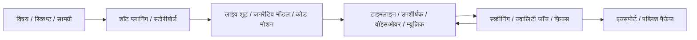

# awesome_ai_video_creation

**ओपन-सोर्स AI वीडियो जनरेशन, वीडियो संपादन, ज्ञान-आधारित शॉर्ट वीडियो, डिजिटल प्रस्तोता, Agent Skills, ComfyUI और मीडिया CLI का संकलन।**

क्यूरेटेड ओपन-सोर्स AI वीडियो जनरेशन, एडिटिंग, एजेंटिक प्रोडक्शन, code-to-video, डिजिटल प्रस्तोता, ComfyUI वर्कफ़्लो, मीडिया CLI और benchmark — प्रमाण-लिंक वाले विवरण और दोबारा चलायी जा सकने वाली GitHub मेंटेनेंस रैंकिंग के साथ।

यह डायरेक्टरी कानूनी रूप से अधिकृत सामग्री के डाउनलोड, स्क्रिप्ट और शॉट प्लानिंग, इमेज/वीडियो जनरेशन, डिजिटल प्रस्तोता, टाइमलाइन संपादन, उपशीर्षक और वॉइसओवर, मोशन, क्वालिटी जाँच से लेकर एक्सपोर्ट तक की पूरी श्रृंखला को कवर करती है। मॉडल, वर्कबेंच, Skill, CLI और benchmark अलग-अलग श्रेणियों में रखे गए हैं।

[श्रेणी सूची](#श्रेणी-सूची) · [प्रोजेक्ट विवरण तालिका](docs/projects.md) · [CLI तुलना](docs/cli-comparison.md) · [रैंकिंग](docs/rankings.md) · [खोज रिकॉर्ड](docs/research.md) · [योगदान](CONTRIBUTING.md)

प्रारंभिक संस्करण एक जाँच-योग्य इकोसिस्टम नक्शा देता है; यह दावा नहीं करता कि सारे वीडियो मॉडल, वाणिज्यिक API या पारंपरिक NLE प्लगइन शामिल हैं।
